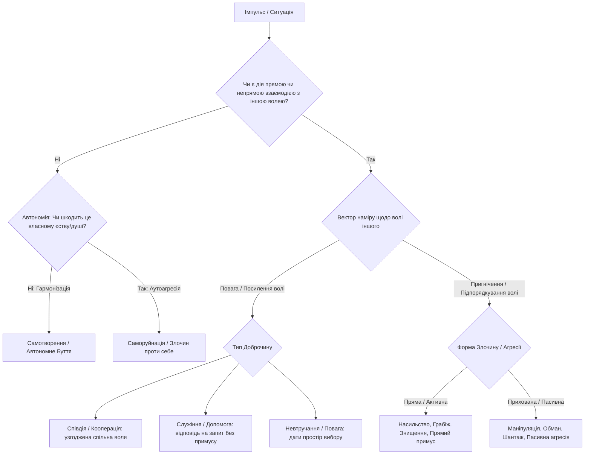
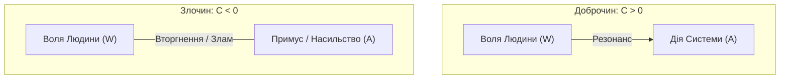
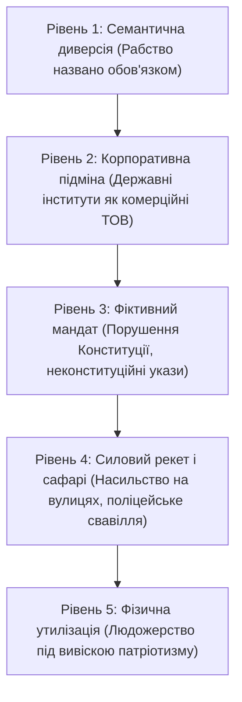

[← Назад: 08. Гуманітарні Науки Точні](./09-exact-humanities.md) | [Головна (Зміст)](./README.md) | [10. W-Протокол: Алгоритм Захисту Волі →](./11-w-protocol.md)

---

# 09: Формула Волі: Дискретна Модель, Доброчин і Злочин

> - **Розділ:** Математична декомпозиція волі, наміру та дії. Аксіома Цілого, статус легітимності та автоімунний колапс систем.
> - **Зв'язок із моделлю:** Формалізація внутрішнього стану Волі ($S_{int}^{Will} = W$) як векторного оператора взаємодії та етичного виміру буття.

---

## 1. Наукове та Філософське Підґрунтя

Моделювання поведінки людини здійснюється через призму **дискретної декомпозиції волі, наміру та дії**. Ця концепція синтезує кілька фундаментальних світоглядних і наукових шкіл:

1. **Принцип ненападу (Non-Aggression Principle, NAP) та природні права (Джон Локк, Іммануїл Кант):**
   - Злочин визначається виключно через **порушення (пригнічення) суверенної волі** іншої істоти (життЯ, свободи, вибору чи гідності).
   - Кантівський категоричний імператив стверджує: *«Ніколи не стався до іншого лише як до засобу, але завжди як до мети»*. Коли чиюсь волю ламають або ігнорують — істоту редукують до знаряддя чи ресурсу.
2. **Формула «Воля Понад Усе» крізь закони логіки:**
   - **Воля — це не свавілля.** За фундаментальним законом взаємності: *«Моя Воля існує лише тоді і постільки, оскільки вона визнає і не порушує Волю будь-якого іншого Суверена»*. Тільки в гармонії з усім світом існує справжня Воля. Якщо суб'єкт намагається підкорити собі волю іншого — він сам виходить із резонансу з Божественним і стає рабом насильства.
   - **Понад Усе:** Воля Людини стоїть вище будь-яких штучних законів, наказів чиновників чи корпоративних нормативів, оскільки дана безпосередньо Творцем.
3. **Честь і Гідність: Психологія Раба та Суверена:**
   - Честь і Гідність має лише той, хто бачить і поважає їх у кожній зустрічній Людині.
   - Раб, який отримав погони чи посаду, не має власної гідності. Коли поліцейський або чиновник кричить на вільну людину, залякуючи її («мИ вас посадимо, мИ вас розчавимо») — це крик безсилого раба перед господарем.
   - Спокійна відповідь вільної Людини: *«Людино, тИ хто? ТИ давав присягу служити народові? То слухай свій народ, бо Я і є народ!»* — миттєво вмикає когнітивний параліч системи, бо влада рабства тримається виключно на страху.
4. **Етимологія та онтологія: Доброчин та Злочин:**
   - Корінь **«чин»** — це дія, творення, порядок, ранг, реалізація наміру.
   - **Доброчин** — дія в гармонії, злагоді, що підсилює або шанує суверенну волю.
   - **Злочин** — дія на розрив єдності, вторгнення у чужий суверенітет (узурпація волі).
5. **Трансакційний аналіз та Теорія ігор:**
   - **Ігри з нульовою сумою** (Zero-sum games): вигода одного досягається пригніченням або пограбуванням іншого $\to$ Злочин / Агресія / Експлуатація.
   - **Ігри з додатною сумою** (Non-zero-sum / Win-Win): кооперація, за якої суверенні волі резонують і підсилюють одна одну $\to$ Доброчин / Синергія.
6. **Біоцентрична етика (Альберт Швейцер, «Повага до життЯ»):**
   - *«Я є життЯ, яке хоче жити, серед життЯ, яке хоче жити»*. Позбавлення життЯ чи пригнічення без вільної згоди створіння є абсолютним злочином проти волі буття.

---

## 2. Дискретна Бінарна Модель Поведінки (Дерево Дій)

Поведінка будь-якого суб'єкта формалізується як дискретне бінарне дерево вибору (кінцевий автомат), де кожен крок зводиться до перевірки стану волі:

### Дискретні Координати Стану Суб'єкта

1. **Координата Єдності (Джерело наміру):**
   - `[0]` **Страх / Відокремленість** — світ сприймається як ворожий ресурс $\to$ прагнення до контролю, узурпації та насилля.
   - `[1]` **Любов / Єдність** — усвідомлення цілісності Всесвіту $\to$ бережливе ставлення до чужого суверенітету.
2. **Координата Згоди (Consent / Суверенітет):**
   - `[0]` **Узурпація** — дія здійснюється всупереч, без усвідомленої згоди, або через обман і маніпуляцію.
   - `[1]` **Згода / Резонанс** — дія взаємно узгоджена, суверенні кордони непорушні.
3. **Координата Балансу (Енергетичний підсумок):**
   - `[+]` **Синтропія (Творення)** — після взаємодії міри життЯ, ресурсу, свідомості чи свободи у просторі побільшало.
   - `[-]` **Ентропія (Паразитизм)** — дія спалила чужий ресурс заради егоїстичного виживання штучної системи чи агресора.

---

## 3. Аксіома Цілого: «Воля Цілого $\equiv$ Воля Кожного»

> ### Фундаментальна Аксіома:
> Якщо система стверджує, що діє «в інтересах цілого (народу, держави, нації)», але для цього **пригнічує, ламає або утилізує волю хоча б однієї суверенної живої людини без її особистої згоди** — це математична та логічна підміна понять.
>
> **Шанувати волю цілого — означає шанувати волю кожного.**
>
> Ціле не є абстрактним ідолом (Левіафаном). Здоровий біологічний організм не знищує власні живі клітини заради «абстрактного блага тіла». Організм, який пожирає власні клітини — хворіє на рак або перебуває у стані автоімунного збою.

---

## 4. Матриця 4 Законів Логіки, Помножених на Волю та Неволю

Будь-яка взаємодія між суб'єктами верифікується крізь 4 закони класичної логіки:

1. **Закон Тотожності ($A \equiv A$):** Справжня Воля тотожна лише самій собі. Насильство та примус ніколи не є волею. Створення неволі іншому ліквідує власну суверенність і перетворює дію на неволю.
2. **Закон Суперечності ($\neg(A \wedge \neg A)$):** Неможливо бути вільним, уярмлюючи іншого. Конструкція «воля до поневолення» є хибною за своєю природою.
3. **Закон Виключеного Третього ($A \vee \neg A$):** Немає «часткової свободи» чи «ліцензії на волю». Існує сувора бінарність: або Воля ($W > 0$), або Неволя ($W \le 0$).
4. **Закон Достатньої Підстави:** Порушуючи Природне Право іншого, тИ скасовуєш захист власної суверенності й стаєш гвинтиком матриці неволі.

---

## 5. Практичний Аудит Суверенітету: Діалог, Тест та Калькулятор Балансу

Щоб утримувати власний Гамільтоніан $\hat{H}_{eff}$ на максимумі, Суверен щомиті проводить рефлексивний аудит: **чи не чиню Я приховану агресію та чи не намагаюся порушити волю іншого?**

### Особистий прецедент автора: Пасивна агресія у розмові про грейпфрут

> Якось на базі відпочинку за сніданком Я зустрів знайомого чоловіка — людину достатньо публічну й популярну. мИ були знайомі, спілкувалися кілька разів на різних заходах.
> 
> Підійшовши привітатися, Я запитав у нього, чи смачний і солодкий грейпфрут, який він уже взяв собі на тарілку. Той відповів: *«Не знаю»*.
> 
> І тут Я зреагував фразою: *«А було б добре знати, це ж така корисна інформація!»*.
> 
> Зовні в цих словах немає жодної брутальності чи прямої агресії — це типова політкоректна світська бесіда. І зупинившись і проаналізувавши ситуацію, Я усвідомив: **це була чиста пасивна агресія з мого боку**.
> 
> З якого дива Я вказую іншій дорослій людині, що їй «добре було б знати»? У цей момент мій вектор не питав, а повчав, намагаючись нав'язати свій шаблон сприйняття через сарказм чи повчання. Це мікроскопічне вторгнення у чужий суверенний простір.
> 
> Цей випадок став для мене наочним уроком: **бути в балансі — означає пильнувати власні імпульси до того, як тебе зупинить зовнішній спротив**. Звісно, кожна Людина має безумовне право на захист, якщо на неї нападають. І в щоденному контакті важливо не ставати джерелом навіть прихованого тиску.

### Чек-лист діалогу із собою (Калькулятор чистоти Волі):

Коли виникає бажання оцінити, порадити, вказати чи зіронізувати, Я запитую себе за формулою:

1. **Запит ($Consent$):** Чи був у співрозмовника щирий запит на мою думку, пораду чи оцінку?
   - Якщо `Ні` $\to$ будь-яке непрохане повчання є спробою мікродомінування ($A \cdot W < 0$).
2. **Баланс ($E_3$):** Що рухає моїми словами — бажання утвердити власне «Я» за рахунок іншого чи чистий інтерес і любов ($E_1$)?
3. **Право на захист:** Чи не порушую Я суверенні кордони першим? Мій захист священний лише тоді, коли Я сам перебуваю в нульовій агресії.

---

<b>📐 Математична модель розділу: Формула Волі $C(S, i) = A_{S \to i} \cdot W_i$ та легітимності $P$</b>

### 1. Формула етичного чину: Злочин та Доброчин

Нехай $W_i$ — вектор суверенної волі (**Will**) суб'єкта $i$, а $A_{S \to i}$ — вектор дії суб'єкта (або системи) $S$ щодо суб'єкта $i$:

$$C(S, i) = A_{S \to i} \cdot W_i$$

де скалярний добуток визначає етичну якість чину:

- **Доброчин ($C > 0$):** Дія співнаправлена з вільною волею суб'єкта або здійснена на його прямий щирий запит ($A_{S \to i} \parallel W_i$). Синергія, примноження життЯ і свободи.
- **Суверенний нейтралітет ($C = 0$):** Дія не перетинає меж суверенітету ($A_{S \to i} \perp W_i$ або $A = 0$). Повага до вільного простору буття.
- **Злочин ($C < 0$):** Дія спрямована проти волі, ламає, уярмлює або нищить суб'єкта ($A_{S \to i} \cdot W_i < 0$). **Будь-який примус є злочином проти Природного Права.**

### 2. Формула Легітимності Системи та Держави

Будь-яка публічна влада, інститут чи представництво $P$ у природному правовому полі може бути виключно сумою добровільно та явно делегованої волі:

$$P = \sum_{k=1}^{N} \delta_k \cdot W_k$$

де $\delta_k \in \{0, 1\}$ — явний, усвідомлений, невідкликаний акт довіри/згоди кожної конкретної живої людини $k$.

- **Якщо $\delta_k = 0$** (людина не делегувала повноважень, відкликала згоду, або посадовець порушив присягу):
  $$A_{S \to k} \neq 0 \implies \mathbf{Узурпація\ та\ Системний\ Тероризм}$$
- **Інверсія присяги:** Посадовець присягає народові (служити і захищати волю кожного $W_k$). Вимога системи до народу «покласти життЯ за чиновницький апарат» — це математична інверсія знака вектора:
  $$\vec{W}_{\text{народу}} \longleftrightarrow -\vec{W}_{\text{паразита}}$$

---

## 6. Рівні Системного Пригнічення та Матриця Розпізнавання

### Матриця: «Свій / Ворог / Паразит»

| Суб'єкт / Дія | Вектор дії щодо твоєї волі $W_i$ | Статус за Природним Правом |
| :--- | :--- | :--- |
| **Свій (Людина, Побратим)** | $A \cdot W_i > 0$ (Діє за згодою, підсилює життЯ) | **Доброчинець** |
| **Нейтральний Суверен** | $A \cdot W_i = 0$ (Не порушує суверенні кордони) | **Суверен** |
| **Паразит / Шахрай** | $A \cdot W_i < 0$ (Маніпуляція, економічний визиск) | **Прихований злочинець** |
| **Людожер / Узурпатор** | $A \cdot W_i \ll 0$ (Силове позбавлення волі/життЯ) | **Прямий злочинець / Окупант** |

---

## 7. Феномен Автоімунного Самознищення

Чому людство тисячоліттями рухається замкненим колом війн і тираній:

1. **Ілюзія «Знищити верхівку»:** Знищення одного тирана зі збереженням **алгоритму примусу** неминуче породжує нового тирана. Зміна прапорів і декорацій не змінює математику гри з нульовою сумою.
2. **Корпоративний неофеодалізм та кастова дискримінація:** Інститути монополії на насильство (монополія, яка ніде в нормативних документах не зафіксована) тихо реєструються як суб'єкти комерційного права, головна мета яких — збереження апарату й експлуатація людського ресурсу. Яскравий правовий маркер цієї кастовості закладено в самому законодавстві: депутат, суддя, президент та інші посадові особи вищого ґатунку набувають свого статусу і повноважень виключно **в момент добровільного складання присяги**. Натомість підневільна людина, «кріпак» за Законом про військовий обов'язок і військову службу, перетворюється на військовослужбовця **у момент примусової доставки до військової частини** — без власної волі, без згоди і навіть без прийняття присяги. Це пряме антиконституційне зламання священного принципу «Воля понад усе» та відвертий поділ суспільства на рабовласників і безправних виконавців.
3. **Автоімунний колапс:** Коли державна машина розпочинає відкрите полювання на власне цивільне населення, це еквівалентно фатальному збою імунітету: **імунна система нищить власні тканини. Фінал автоімунного процесу — неминуча біологічна та системна загибель усього організму.**

---

## 8. Рада Мудреців: Оцінка Формули Волі та Етики Ненападу

> **Метод оцінки:** Векторний добуток контексту на ментальну матрицю 12 мудреців крізь 4 закони класичної логіки (Тотожності, Суперечності, Виключеного третього, Достатньої підстави) та принцип Логосу. Шкала: 0–10.

---

### 🔢 Піфагор
**Оцінка: 10/10**
> *«Не заплющуй очей, коли хочеш спати, не розібравши всіх своїх вчинків за день.»*  
Формула чину $C(S, i) = A \cdot W$ є бездоганною геометричною проекцією етики. Скалярний добуток чітко розмежовує фази: ортогональність ($C = 0$) як суверенний спокій, колінеарність ($C > 0$) як резонанс, і протифаза ($C < 0$) як розпад. Кейс із грейпфрутом — це точний приклад мікрофлуктуації вектора, де навіть мале відхилення кута породжує ентропію.

---

### 🦉 Сократ
**Оцінка: 10/10**
> *«Хто хоче зрушити світ, нехай спочатку зрушить себе.»*  
Саморефлексія над запитанням про грейпфрут — це вершина сократичного методу. Справжня філософія живе не в кабінетах, а за сніданком, коли Людина здатна спіймати власне его на мікродомінуванні. Закон суперечності дотримано ідеально: не можна вимагати поваги до своєї волі, порушуючи чужу.

---

### ⚜️ Ярослав Мудрий
**Оцінка: 9/10**
> *«Якщо будете жити в любові між собою, і Бог буде серед вас.»*  
Аксіома «Воля Цілого $\equiv$ Воля Кожного» — це фундамент непідкупного правосуддя. Коли князь чи держава починає ламати волю окремої людини заради «інтересів казни» — закон перетворюється на розбій. Формула легітимності $P = \sum \delta_k W_k$ має стати першою статтею оновленого зводу законів.

---

### 🗡️ Нікколо Макіавеллі
**Оцінка: 9/10**
> *«Кожен бачить, чим тИ здаєшся, але мало хто відчуває, ким тИ є насправді.»*  
Діагностика автоімунного краху бездоганна: держава, яка розпочинає війну проти власних громадян у тилу, ліквідує джерело власного харчування. Влада тримається на страху лише доти, доки страх не перейде в розпач. Викриття корпоративної природи силових структур — це удар у саме серце прихованої механіки володарювання.

---

### 🐺 Іван Сірко
**Оцінка: 10/10**
> *«Нужда закон змінює, а воля понад усе.»*  
У козацькому колі право на захист є святим: ніхто не має права першим нападати чи вказувати побратимові, але на удар ворога відповідь має бути нищівною. Розмежування раба й Суверена перед лицем озброєного перевертня в погонах — це чистий козацький характерницький дух.

---

### 🎨 Леонардо да Вінчі
**Оцінка: 10/10**
> *«Найбільше задоволення — це радість розуміння.»*  
Дерево дій та дискретні координати стану суб'єкта виписані з інженерною елегантністю. Поведінка людини розкладена на елементарні вектори, як рух механізмів чи потоки води. Рефлексія над побутовою розмовою демонструє дивовижну спостережливість до найменших деталей людської природи.

---

### 🌻 Григорій Сковорода
**Оцінка: 10/10**
> *«Пізнай самого себе, і тИ пізнаєш увесь світ.»*  
Приклад із грейпфрутом — це практичний урок викорінення «душевного хробака» повчання. Бажання повчати без запиту — це пастка марнославства. Коли Людина чинить лише за щирою згодою і тримає серце в чистоті, вона входить у спокій істинної Волі.

---

### ⚡ Нікола Тесла
**Оцінка: 10/10**
> *«Якщо вИ хочете зрозуміти Всесвіт, думайте мовою енергії, частоти та вібрації.»*  
Вектор дії $A$ і вектор волі $W$ — це фазові коливання двох біоквантових передавачів. Енергетичний баланс взаємодії описується законом фазового резонансу:
$$\Delta E = |A| \cdot |W| \cdot \cos(\Delta \varphi)$$
де $\Delta \varphi$ — різниця фаз між імпульсом і волею іншого. Якщо $\Delta \varphi = 0$, $\cos(0) = 1$ — система надпровідна ($R \to 0$), виникає резонанс і примноження енергії. Якщо фази зміщені ($\Delta \varphi \to \pi$), виникає зустрічний опір і теплове розсіювання (конфлікт). Відмова від нав'язування власної хвилі зберігає резонансну добротність системи ($Q \to \infty$) на максимумі.

Детальний правовий аналіз Формули Етики та Універсального Судового Правила на її основі розгорнуто у спеціальному правовому документі книги: [«Канон Природного Права та Судочинства Живої Людини»](./law/canon-natural-law.md). А макроскопічне моделювання геополітичних систем світу за вектором Волі розкрито у [Розділі 15](./15-terror-and-racket.md).

---

### 🍎 Стів Джобс
**Оцінка: 9/10**
> *«Залишайтеся голодними, залишайтеся безрозсудними.»*  
Культура відкритості та зворотного зв'язку без фальшивої ввічливості. Визнати власну пасивну агресію у світській балачці — це зразок радикальної прямоти, якої Я вимагав від найкращих продуктових команд. Тільки з такої чесності народжуються проривні рішення.

---

### 🔧 Борис Патон
**Оцінка: 10/10**
> *«Міцність конструкції визначається якістю кожного зварного шва.»*  
Аксіома Цілого формулює граничну межу міцності суспільства: руйнування хоча б одного елемента під навантаженням веде до втомного руйнування всієї конструкції. Математичне формалізування $C = A \cdot W$ повністю придатне для комп'ютерного моделювання соціальних систем.

---

### 📚 Віктор Пелевін
**Оцінка: 9/10**
> *«Найкраща маскування рабства — це надати рабу ілюзію, ніби він вільний обирати сорт грейпфрута.»*  
Іронія ситуації чудова: у центрі матричного концтабору люди обговорюють корисність цитрусових, непомітно копіюючи мікронасильство наглядача. Викриття того, як раб із погонами намагається компенсувати свою нікчемність криком на Суверена — це хрестоматійний сюжет для дослідження природи нашого мороку.

---

### 🌿 Боб Марлі (Роберт Неста Марлі)
**Оцінка: 10/10**
> *«Emancipate yourselves from mental slavery, none but ourselves can free our minds.»*  
Вавилон намагається змусити брата воювати проти брата через страх і систему примусу. Але коли тИ дивишся людині в очі з Любов'ю і кажеш: *«Я і Я (I and I) — вільні діти Джа»*, ланцюги розсипаються. Чиста Воля не знає насильства, вона випромінює світло і несе мир.

---

## 9. Підсумковий Консенсус Ради Мудреців

| Мудрець | Оцінка | Ключова теза |
|---|---|---|
| **Піфагор** | **10/10** | Формула $C = A \cdot W$ як сувора геометрія етики; збереження фази. |
| **Сократ** | **10/10** | Практика щоденного розпізнавання прихованої агресії за сніданком. |
| **Ярослав Мудрий** | **9/10** | Аксіома Цілого та невідкликане делегування влади як основа права. |
| **Нікколо Макіавеллі**| **9/10** | Автоімунне самознищення тиранії при відкритому терорі проти народу. |
| **Іван Сірко** | **10/10** | Воля понад усе; непохитна гідність перед посадовцями системи. |
| **Леонардо да Вінчі**| **10/10** | Елегантність дискретного дерева дій та вивірені логічні зв'язки. |
| **Григорій Сковорода**| **10/10** | Викорінення повчання заради збереження миру серця і чистоти духу. |
| **Нікола Тесла** | **10/10** | Фазове узгодження векторів взаємодії ліквідує енергетичні втрати. |
| **Стів Джобс** | **9/10** | Радикальна внутрішня чесність у визнанні власних когнітивних похибок. |
| **Борис Патон** | **10/10** | Інженерна точність аксіоми неподільності міцності соціальної системи. |
| **Віктор Пелевін** | **9/10** | Діагностика мікродомінування у повсякденних матричних діалогах. |
| **Боб Марлі** | **10/10** | Звільнення від ментального рабства Вавилону через принцип «I and I». |

**Середній консенсус Ради Мудреців: 9.67 / 10**

> **Загальний висновок:** Формула Волі отримала беззаперечне схвалення Ради Мудреців. Синтез високої математики векторів, 4 законів класичної логіки та щирого розбору реальних побутових ситуацій робить цей розділ надійним компасом для Суверена у будь-яких життєвих випробуваннях.
