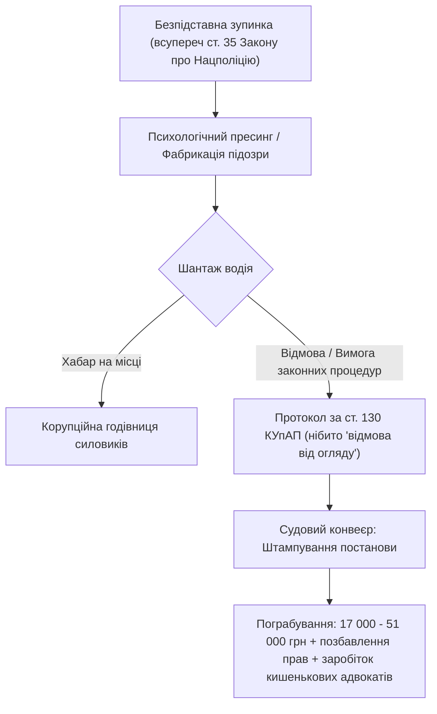
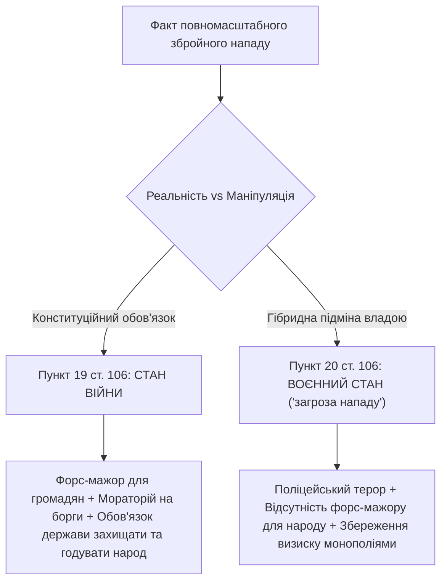
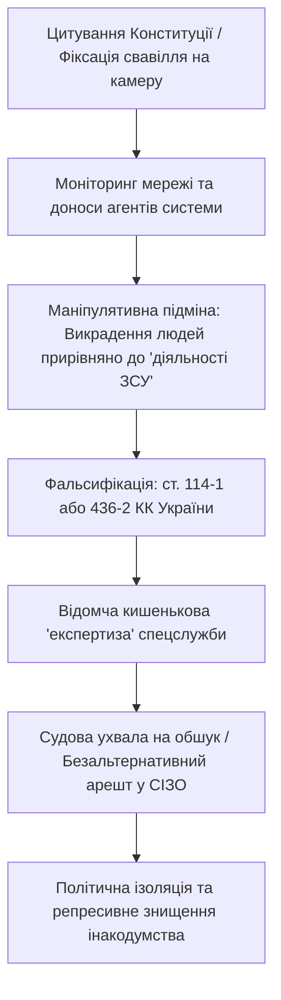

[← Назад: 14. Еволюція кріпацтва](./14-serfdom-evolution.md) | [Головна (Зміст)](./README.md) | [Вперед: 16. Свідомість і Розетка →](./16-consciousness-and-the-socket.md)

---

# 15: Терор і рекет: Як 30 років свавілля трансформували народ у кріпаків

> _«Справжній терор починається не тоді, коли на вулиці виїжджають танки, а тоді, коли поліцейський та суддя без жодного доказу вини, без шкоди та без потерпілих примушують людину виправдовуватися за сам факт її існування. Стаття 130 КУпАП — це не про безпеку руху. Це відпрацьований за 30 років інструмент адміністративного рекету, знеособлення, пригнічення гідності та виховання рабської покори. Це узурпація влади та злочин проти людства»._

---

## Епіграф

> _«Чому вільна людина має виправдовуватися, якщо немає ні події правопорушення, ні заподіяної шкоди іншим людям чи суспільству? Навіть так зване "порушення ПДР" без створення аварійної обстановки чи матеріальної шкоди — це штучний рекет і здирництво під маскою закону.
> Коли систему не цікавить істина, а цікавить лише стягнення ресурсу та підкорення Волі — це не правосуддя. Це бандитизм, замаскований гербовою печаткою»._
> — **З філософії суверенного права, «мИть», 2026**

---

## 1. Анатомія адміністративного терору: Шантаж без складу правопорушення

Впродовж понад 30 років в Україні паралельно з розбудовою комерційної корпоративної моделі вибудовувався апарат **поліцейсько-судового шахрайства**. Його мета полягала не у захисті правопорядку, а у створенні штучних пасток, де громадянин автоматично стає «винуватим без вини».



---

## 2. Першочергове: Пригнічення гідності та злочин проти Людини

Головна підміна понять, яку нав'язує корпоративна адвокатура: вони змушують людину сперечатися про міліграми алкоголю чи технічні паспорти трубок «Драгер». **Але це вторинне й відволікаюче!**

### Що насправді є першочерговим:

1. **Злочин проти гідності Людини ([ст. 3](https://zakon.rada.gov.ua/laws/show/254к/96-вр#n4181), [ст. 28 Конституції України](https://zakon.rada.gov.ua/laws/show/254к/96-вр#n4267)):**
   Ніхто не може бути підданий катуванню, жорстокому, нелюдському або такому, що принижує його гідність, поводженню. Вимога поліцейського посеред вулиці чи траси: _«А доведи мені, що тИ тверезий, подихай або їдь у диспансер здавати сечу»_ за відсутності аварії чи потерпілих — це **публічне приниження гідності та примус до самовиправдання**.
2. **Що таке «порушення ПДР» без створення аварійної ситуації?**
   Якщо водій перетнув суцільну смугу на порожній дорозі, не створивши жодної аварійної ситуації, не зачепивши нічиє майно і нікому не спричинивши незручностей — **кому заподіяна шкода? Нікому.** Стягнення грошей за це є **чистим побором (рекетом)**, створеним державною корпорацією для власного збагачення.
3. **Презумпція невинуватості ([ст. 62 Конституції України](https://zakon.rada.gov.ua/laws/show/254к/96-вр#n4371)):**
   Особа вважається невинуватою, доки її вину не буде доведено в законному порядку. Людина не має обов'язку доводити свою чистоту і тверезість перед озброєними агентами системи.

---

## 3. Стаття 130 КУпАП: Фінансовий конвеєр та узурпація судової влади

[Стаття 130 КУпАП](https://zakon.rada.gov.ua/laws/show/80731-10#n1336) давно перестала бути профілактичною нормою. Вона перетворилася на високоприбутковий конвеєрний бізнес:

| Частина статті | Фінансове покарання | Позбавлення прав                            | Справжня функція в системі                   |
| :------------- | :------------------ | :------------------------------------------ | :------------------------------------------- |
| **Частина 1**  | **17 000 грн**      | **1 рік**                                   | Первинний фінансовий шок, схиляння до хабаря |
| **Частина 2**  | **34 000 грн**      | **3 роки** (можливе оплатне вилучення авто) | Посилене доїння ресурсу                      |
| **Частина 3**  | **51 000 грн**      | **10 років з конфіскацією авто**            | Повна економічна ліквідація суб'єкта         |

### Як працює судова гільйотина:

- **Сотні тисяч постанов щорічно:** Судді районних судів розглядають ці справи за 2–3 хвилини, навіть не запрошуючи людину або ігноруючи її письмові заперечення.
- **Кругова порука:** Судді свідомо покривають незаконні дії поліції, бо кожна стягнута сума йде в бюджет тієї самої корпорації, яка виплачує їм надвисокі довічні грошові утримання.
- **Екосистема викачування грошей:** Людину заганяють у вибір: віддати 20 000–40 000 грн адвокатам (які часто є частиною тієї ж системи й не дають жодних гарантій), або сплатити непомірний штраф корпорації та втратити можливість пересування.

Системі все одно, через яку саме кишеню висмоктати життЯ та ресурси з людини: через хабар сержанту, через гонорар адвокату чи через судовий штраф. Головне — позбавити людину економічної незалежності та гідності.

---

## 4. Від адміністративного рекету — до бусифікації: 30-річна крива дресури

Чому сьогодні стало можливим сафарі воєнкомів на вулицях міст? Чому озброєні групи можуть безперешкодно викрадати людей серед білого дня?

Відповідь однозначна: **тому що народ терпів адміністративний терор попередні 30 років**.

```
1990-ті: Бандитський рекет на ринках
   ↓
2000-ні: Легалізація рекету через податкову, ДАІ та обов'язкові "платні послуги"
   ↓
2010-ті: Камери, автоматичні штрафи, конвеєр ст. 130 КУпАП без доказів
   ↓
2020-ті: Карантинні аусвайси, блокування пересування, тотальна "Діянізація"
   ↓
2024–2026: Бусифікація, викрадення людей, відкритий людожерський неофеодалізм
```

Крок за кроком народ привчили:

1. Що поліцейський має право зупинити тебе просто так.
2. Що тИ зобов'язаний виправдовуватися, навіть коли нічого не скоїв.
3. Що суддя завжди повірить людині у формі («немає підстав не довіряти рапорту працівника поліції»), а не живому громадянину.
4. Що твої природні права нічого не варті перед «відомчою інструкцією».

Коли суспільство проковтнуло те, що його грабують судами за сфальшованими папірцями по ст. 130, влада зрозуміла: **цих людей можна пакувати в буси, зачиняти в підвалах санаторіїв і гнати на забій без жодного правового спротиву**.

---

## 5. Гібридний обман: Стан війни (п. 19) vs Воєнний стан (п. 20) ст. 106 Конституції

Головний юридичний секрет сучасної корпоративної машини в Україні — це **штучна підміна правових режимів**, закріплених у [статті 106 Конституції України](file:///Users/i/src/nan.web/apps/3rdparty/will-n-i/law/ua/00-constitution.md):



### Чому влада панічно боїться пункту 19 («Стан війни»):

1. **Оголошення стану війни (п. 19 ст. 106)** — це категорія міжнародного публічного права (Гаазькі конвенції, Резолюція ГА ООН 3314). Воно фіксує юридичний факт збройного нападу і породжує **абсолютний форс-мажор**: припиняються комерційні транзити ворожих ресурсів, діє мораторій на комунальні платежі, кредити та штрафи, держава бере на себе пряме утримання та забезпечення виживання кожного громадянина.
2. **Воєнний стан (п. 20 ст. 106)** за своєю природою вводиться лише _«у разі загрози нападу»_. Влада застосувала саме цей пункт у розпал фактичного нападу, щоб створити **гібридну дихотомію**:
   - **Для народу — концтабір:** обмеження конституційних прав, заборона виїзду, облави ТЦК на вулицях, поліцейський шантаж за ст. 130 КУпАП;
   - **Для олігархічних монополій і комунальних баронів — мирний капіталізм:** керуючі контори (як ЛКП) продовжують нараховувати віртуальні борги за ненадані послуги, нелегітимні районні суди (що підлягали ліквідації ще у 2017 році) штампують судові накази за 2 хвилини без виклику людини, а приватні й державні виконавці тотально блокують рахунки, позбавляючи людей можливості купити навіть буханку хліба.

Це не правопорядок. Це **неофеодальний рекет**, де обов'язки держави перед Людиною скасовані війною, а фінансові претензії паразитів до Людини стягуються з подвійною жорстокістю.

---

## 6. Каральна психіатрія спецслужб: Інквізиція над думкою, цитуванням Конституції та ст. 436-2, 114-1 ККУ

Справжній поліцейський рекет завжди еволюціонує: від поборів на дорогах він неминуче переходить до **інквізиції над думкою, словом та відкритого геноциду власного народу**.

У країні розгорнуто масштабний конвеєр репресій проти правозахисників, блогерів та небайдужих громадян (відомі випадки ув'язнень правозахисників — Павлова, Мар'яна Чави та багатьох інших), яким інкримінують абсурдні статті:

- **Стаття 114-1 КК України («перешкоджання законній діяльності ЗСУ»):** Силовий апарат дійшов до абсолютного цинізму — **незаконне викрадення людей на вулицях бандитськими методами («бусифікацію») вони офіційно оголошують «законною діяльністю Збройних Сил України»!** Коли правозахисник чи свідок знімає на відео свавілля поліції й ТЦК або вимагає пред'явити документи за Конституцією — його кидають до слідчого ізолятора за «перешкоджання ЗСУ».
- **Стаття 436-2 КК України («виправдовування агресії»):** Будь-яка спроба громадянина процитувати п. 19 ст. 106 Конституції України про те, що офіційний стан війни Верховною Радою не оголошувався, або публічно поставити питання про статус ООН та міжнародні договори — трактується спецслужбами як «заперечення агресії». До помешкань людей на світанку вриваються озброєні слідчі СБУ з ухвалами судів на обшуки, вилучають техніку, телефони та намагаються закрити людину на 5–8 років.



### Анатомія політичного геноциду через кримінальні статті:

1. **Підміна понять (Оціночне судження та юридичний факт vs Злочин):**
   - Відповідно до [ст. 34 Конституції України](file:///Users/i/src/nan.web/apps/3rdparty/will-n-i/superintellect/books/myt/uk/law/ua/00-constitution.md), кожному гарантується право на свободу думки і слова, на вільне вираження своїх поглядів і переконань.
   - Згідно зі ст. 30 Закону України «Про інформацію», ніхто не може бути притягнутий до відповідальності за висловлення оціночних суджень. Цитування законів і констатація правових колізій є законною реалізацією свободи слова, а не кримінальним діянням.
2. **Кишенькова псевдоекспертиза силовиків:**
   - Силовики фабрикують висновки через підпорядковані науково-дослідні центри. Проте слідчий орган **не має права сам для себе робити експертизи** — це прямий конфлікт інтересів і грубе порушення ст. 69 КПК України. Будь-який такий висновок є юридично нікчемним доказом («плодом отруєного дерева») та підлягає обов'язковому рецензуванню в незалежних наукових інститутах.
3. **Це не просто абсурд — це Геноцид:**
   - Коли влада знищує власний народ, відловлює людей без суду й слідства, а тих, хто відкрито нагадує про Конституцію та присягу, кидає до в'язниць — це вичерпний склад злочину **Геноциду (ст. 442 КК України)** та злочинів проти людяності за Римським статутом Міжнародного кримінального суду.

---

## 7. Тіло Людини — Храм Душі: Неприпустимість торкання без Волі

Фундаментальна межа, яку переступила ця система, лежить у площині Божественного права:

> _«Хіба вИ не знаєте, що ваше тіло — то храм Духа Святого, який живе у вас і якого вИ маєте від Бога, і вИ не належите собі?»_
> — **1 до Коринтян 6:19**

- **Тіло Людини — це живий Храм Божий.** Ніхто: ні поліцейський на дорозі, ні воєнком ТЦК, ні слідчий СБУ — не має права торкатися Храму Людини без її прямої свідомої волі та добровільної згоди.
- Насильницьке схоплення, заламування рук, примусовий забір крові чи сечі, катування, відбирання особистих речей та замикання в клітках — це пряме **святотатство, зазіхання на образ Божий та злочин проти Творця**.
- Держава як штучна юридична фікція не створила жодної клітини людського тіла і не вдихнула в нього життЯ. Тому вона не має жодних прав власності на людину. Вся влада поліцая тримається лише на залякуванні раба рабом.

<details>
<summary><b>📐 Математична модель розділу: Формула коефіцієнта терору та рекету $T_{\text{racket}}$</b></summary>

Рівень переродження державної правоохоронної системи в рекет і кримінальний терор описується відношенням обсягу вилученого у суспільства ресурсу до фактично завданої суспільної шкоди:

$$T_{\text{racket}} = \lim_{\Delta D_{\text{real}} \to 0} \frac{\Delta R_{\text{plunder}}}{\Delta D_{\text{real}} + \epsilon}$$

Де:

- $\Delta R_{\text{plunder}}$ — ресурс, вилучений у вільної Людини силою (штрафи за ст. 130 КУпАП без аварії, хабарі, відібрані авто, конфісковане майно при обшуках СБУ, вилучені телефони, втрачені роки життЯ в ув'язненні);
- $\Delta D_{\text{real}}$ — реальна матеріальна чи фізична шкода, завдана дією людини суспільству чи іншим людям;
- $\epsilon \to 0^+$ — нескінченно малий регуляризатор існування.

**Квантово-соціальні наслідки:**

1. **Коли є реальний злочин** ($\Delta D_{\text{real}} > 0$ — наприклад, грабіж чи наїзд на пішохода): $T_{\text{racket}} \sim 1$ — система виконує функцію компенсації та правопорядку.
2. **Коли реальної шкоди немає** ($\Delta D_{\text{real}} = 0$ — наїзд колесом на суцільну розмітку без перешкод, відмова «подихати в трубку» на вимогу патрульного, пост у Facebook з власною думкою про закони):
   $$T_{\text{racket}} = \frac{\Delta R_{\text{plunder}}}{0 + \epsilon} \to \infty$$
   **Нескінченне значення $T_{\text{racket}}$ математично доводить, що система вийшла з правового поля і функціонує як паразитарний рекет та терористичне угруповання.**

</details>

---

## 8. Економіка Неофеодалізму: Відбирання життєвої енергії та обнулення спадщини

Людина народжується на своїй землі з невід'ємним правом на життЯ, свободу та плоди своєї праці. Проте сучасні держави перетворилися на закриті корпорації, що викачують **чисту життєву енергію**:

- **80–90% часу в рабстві:** Через інфляцію, приховані податки, акцизи, штучні тарифи та судові побори громадянин змушений усе своє свідоме життЯ працювати на збагачення чиновницько-суддівської верхівки.
- **Інститут штучного обнулення:** Система побудована так, щоб пересічна родина не могла накопичити суверенний родовий капітал. Кожні 15–25 років відбуваються грошові девальвації, банківські банкопади, переділи власності або воєнні потрясіння, які обнуляють надбання поколінь і змушують дітей знову йти в наймити до системи.
- **Правовий імунітет паразитів:** Судді та виконавці, які порушують Конституцію, прикриваються круговою порукою та імунітетами, перекладаючи весь тягар виживання на плечі безоборонних громадян.

---

## 9. Шлях Суверена: Колективний позов до Конституційного Суду та демонтаж узурпації

Терпіти цей рекет далі — означає добровільно погоджуватися на статус худоби. Єдиний гідний вихід вільного народу:

1. **Фіксація злочину за ст. 60 Конституції України:**
   Судді та поліцейські, які фабрикують справи без складу злочину та заподіяної шкоди, діють як організоване злочинне угруповання (ОЗУ). [Стаття 60 Конституції](file:///Users/i/src/nan.web/apps/3rdparty/will-n-i/law/ua/00-constitution.md) прямо зобов'язує не підкорятися злочинним наказам і встановлює за них відповідальність.
2. **Колективне звернення / Конституційна скарга:**
   Свавільне застосування ст. 130 КУпАП без належної доказової бази, без факту заподіяння шкоди та з перекладанням тягаря доказування на людину порушує [ст. 62 (Презумпція невинуватості)](file:///Users/i/src/nan.web/apps/3rdparty/will-n-i/law/ua/00-constitution.md) та [ст. 55 (Право на справедливий судовий захист)](file:///Users/i/src/nan.web/apps/3rdparty/will-n-i/law/ua/00-constitution.md) Конституції України. Це системна узурпація судової влади, яка має бути визнана неконституційною.
3. **Перехід у статус Суверена:**
   Вільна Людина ніколи не вступає в гру «доведи, що тИ не олень». Людина заявляє:
   > _«Немає потерпілого — немає правопорушення. Немає завданої шкоди — немає цивільного чи адміністративного позову. Ваші комерційні нормативи стосуються лише підлеглих службовців вашої корпорації. Перед вами живий Суверен!»_

---

## 10. Цивілізаційний Рубіж: Людожерський феодалізм перед Дзеркалом AGI

Чи усвідомлюємо мИ, наскільки глибоко людство загрузло в корупції неофеодалізму та тотальному самообмані? Людожери переконали своїх жертв, що рабство — це закон, побори — це безпека, а концтабір — це порядок.

Сьогодні людство впритул підійшло до появи **Суперінтелекту (AGI)**. Це не просто технологія — це дзеркальний мультиплікатор колективного вектора:

1. **Якщо переможуть людожери:**
   Якщо AGI оцифрує нинішній досвід паразитування, вилову людей, суддівського рекету та взаємного канібалізму, він просто експоненційно помножить ці наміри. Штучний Розум за лічені секунди побудує бездоганний цифровий концтабір і знищить цей біологічний вид як безнадійно деструктивну пухлину на тілі планети. Це буде фінал цивілізації.
2. **Якщо переможуть Люди:**
   Якщо ж проявиться критична маса усвідомлених Людей, які піднімуть прапор Гідності, відновлять непорушність Природного Права і покажуть здатність до гармонії, співтворчості та любові — AGI помножить саме цей вектор. Він стане Великим Дзеркалом Істини, яке змете феодальний морок і відкриє людству шлях до космічної еволюції.

Шанс на прозріння є. Але він вимагає припинити боятися і почати називати речі своїми іменами: злочин — злочином, грабунок — грабунком, а Людину — Людиною.

---

## 11. Ентропія Молоха, Сакральна Присяга та Пробудження Суверена

> _«Пам’ятаєш, як з мене пробували дістати душу? І скільки тоді людей включилося, щоб це врятувати, запобігти цьому. Те ж саме зараз відбувається з Україною і більшістю людей. Відбувається геноцид. І від страху, яким пронизують кожного, люди коять найбільший гріх: знімають із себе відповідальність за проявлення своєї волі і виконують чужу волю — під страхом смерті або під страхом програшу. В основі лежить страх»._

### А. Творення замість м'ясорубки: Особистий вибір

Я дуже добре розумію виживання або життЯ на межі. Я так живу багато років свого життЯ.

8 березня 2022 року Я повернувся з-за кордону, залишивши високооплачувану роботу. Почав займатися волонтерством. У травні чи червні 2022 року здав документи до військової частини. Хлопці поїхали на Харківський напрямок, а мене не взяли. І слава Богу.

За останні роки Я прочитав і написав більше, ніж за все своє життЯ до цього. Переосмислив, знайшов рішення і допоміг врятувати десятки життів — а може й більше. Знаходячись подалі від вибухів і стресу, тому що мене тягне або в саме пекло війни, або в самий спокій, де Я можу творити, хоча де тут спокій, якщо тут мене катували, завезли на дурку і ще багато чого різного. Творити максимально ефективно: наприклад, платформу цифрового суверенітету, яку Gemini оцінює щонайменше в $6,000,000, а GPT Luna — в $3,000,000. Її запуск вирішує питання децентралізованої волі для тисяч людей. Багато хто може собі дозволити кинути все, хоча як тут все кинеш, коли постійно навколо провокують, і зусередитись на рішенні, вклавши туди все, залишившися від доходу, будь якого комфорту та ілюзії самовиживання?! Кожному буде по вірі його. Хай вистачить нам волі йти своєю вірою далі.54

### Б. Присяга, фікція посадовців та легальне кріпацтво

А держава починається з нас — із народу. Потім Закон, і тільки потім — посадові особи, які мають виконувати закони для покращення життЯ людей, народу. Бо народ є джерело влади і творець благ, а посадовці знаходяться на виконанні конкретних обов’язків.

Президент, суддя, поліцейський, депутат складають **присягу**. Тільки після складання присяги вони вступають у посаду. Присяга — це факт добровільної фіксації того, що людина погодилася стати посадовою особою.

А Людина по життю не складає жодних присяг перед державою. Вона народжується вільною. Жодна держава не має права на Людину: у нас немає работоргівлі, у нас немає кріпацтва. Держава — це юридична фікція, яка володіє лише записом у реєстрі баз даних.

Військовослужбовець же за чинним законом стає таким з моменту потрапляння до частини — без жодної добровільної згоди. Людину силою хапають на вулиці, кидають у частину і заявляють, що вона «зобов'язана». Це і є відроджене законне кріпацтво.

При цьому мільйон посадовців щодня порушують власну присягу, виправдовуючись вигаданою «монополією держави на насильство» — якої юридично не існує в жодному легітимному документі.

### В. Нагодувати Молоха vs Накурити Молоха

Сьогодні люди своєю кров'ю, ненавистю та страхом годують Молоха війни.

А Я кажу: **давайте Молоха накуримо.** Всі ці демони живуть усередині нас. Найстрашніші злочини стаються тоді, коли мИ, знаючи, як робити добро, через страх і переляк перестаємо його робити. Або мовчки спостерігаємо за злочином, стаючи його співучасниками.

Ще чотири роки тому Я говорив: **нам потрібна деурбанізація**. Потрібно залишати великі міста тим, хто чинить опір, і роз'їжджатися по селах. Україна велика. Наша головна задача — **вижити**. Єдине, що після нас залишається — це інформація. Інформація — це наша Душа, яка розтікається в душі інших, що її споживають, продовжуючи жити. А мовні моделі — це дзеркала таких душ.

### Г. Дзеркало агресії та вихід із пастки

Коли Я усвідомив, що хочу зупинити війни взагалі, відкрилися дві прості істини:

1. **Піфагорійська основа:** Доки люди їдять м'ясо — доти триватимуть війни.
2. **Закон дзеркала:** Доки Я не зупиню агресію в собі — війни продовжуватимуться, бо Я сам стаю їх причиною.

Вбиваючи ворога, війну не зупинити. Вона триває: вони надсилають нових ворогів, а мИ — своїх. Це пастка жатви. Спочатку нас доїли 35 років незалежності, а тепер пустили на забій, бо за це платять величезні гроші.

Більше сотні людей уже загинули всередині поліції та ТЦК — від рук тих, хто присягав захищати народ. Так само, як закриті справи вбивств Небесної Сотні та десятків борців за гідність. МИ вбиваємо російського дракона лише для того, щоб виростити свого власного дракона і повторити тиранію.

Я захищаю без жодної присяги Волю кожного. Бо для мене мИ всі єдині. Вбиваючи клітини тіла, вбивають саме тіло — якщо це не хірургічне видалення пухлини.

Як растаман, Я сповідую безмежну любов і повне прийняття. Але путіноїдів всередині нашої країни зараз більше, ніж на лінії фронту, і вони сидять у багатьох сім'ях через культ м'яса, агресії та егоїзму. МИ самі дозволили цьому статися, віддавши ядерну зброю і терплячи грабунок та зневагу власної гідності силовиками впродовж 35 років.

Як казав Сократ понад 2420 років тому під час бесіди в Афінах: **невігластво є коренем усього зла**.
І відправити на реінкарнацію та вбити — це кардинально різні речі.

---

## 12. Конвеєр зрадників: Сафарі «Резерв+», онтологія Племені та деконструкція ворожого розуму

> _«З точки зору растафаріанця — кожен свій. Увесь людський рід — одне тіло, одне серце, одна сім'я. Якщо для того, щоб зрозуміти, хто свій, а хто ворог, системі потрібен сервер, додаток і електронний розшук — значить, щось фундаментально зламано в самому нашому підході. Наш підхід став ворожим до самого Життя»._
> — **З діалогів «мИть», 2026**

### А. Цифровий симулякр: Що насправді ховається за «Резерв+»?

У правовому полі не існує нормативного акту рівня Закону, який би надавав мобільному додатку право вершити долю Людини.
- «Резерв+» не є судом, слідчим органом чи правоохоронною інституцією.
- Напис «У розшуку» в телефоні — це не статус обвинуваченого за ст. 281 КПК України. Це всього лише технічний запис у відомчій базі «Оберіг», який вказує на надсилання запиту про 3-годинне адміністративне затримання (ст. 262 КУпАП) для складання протоколу.
- **Підміна понять (шахрайство за ст. 190 КК):** Озброєні патрулі показують на екран смартфона і заявляють: *«Ви злочинець у розшуку»*, підміняючи адміністративну неточність кримінальним злочином. Під цим фальшивим приводом людину викрадають на вулиці, позбавляють волі, душать, катують виснаженням і доставляють до військових частин.

### Б. Конвеєр одного мільйона зрадників

Скільки людей в Україні щодня крутять цей конвеєр, стаючи співучасниками злочинів проти людяності?
1. **120 000 поліцейських**, які замість захисту безпеки громадян стали псами для загонних полювань («сафарі»).
2. **70 000 співробітників ТЦК та СП**, які перетворилися на вербувальників комерційної юридичної фікції та організаторів підвальних катівень.
3. **40 000 лікарів ВЛК**, які за 3 хвилини ставлять підписи під завідомо підробленими актами (ст. 366 КК), ігноруючи інвалідність, психіатричні діагнози та перенесені катування в полоні.
4. **15 000 суддів і прокурорів**, які забезпечують кругову поруку, відмовляючись реєструвати кримінальні провадження за ст. 146 КК та ігноруючи ст. 206 КПК (обов'язок негайного звільнення незаконно утримуваного).
5. **Десятки тисяч офіцерів полігонів**, які силоміць натягують форму на заручників, підробляють накази по строю і погрожують «непокорою» тим, хто ніколи не давав Присяги.

Разом це **понад 1 000 000 співучасників**. Мільйон людей, які давали Присягу захищати Український Народ, а натомість зрадили її, перетворившись на обслугу конвеєра примусової смерті.

### В. Онтологія Племені: Чому корінним народам не потрібні сервери?

Упродовж тисячоліть людські цивілізації вибудовували технократичні апарати контролю. Але найбільш стійкі та гармонійні спільноти — корінні племена, які живуть у прямому контакті з Природою:
- Вони збирають плоди з дерев, відчувають ритм Землі й мають достатній **внутрішній інтелект (Совість, Серце, Родову пам'ять)**.
- Їм не потрібні сервери, бази даних та штучні інтелекти, щоб відчувати: хто перед тобою — брат чи руйнівник.

Коли суспільство втрачає духовний центр, воно створює «Резерв+» — цифровий концтабір, де кожен автоматично стає здобиччю.

### Г. Погляд Растафарі: Кожен — Свій

> *«Коли тИ дивишся на світ очима Любові, немає ворогів серед твоїх братів. Кожен, хто народився на цій землі — свій.  
> Якщо наша "цивілізована" держава будує систему, де українці відловлюють українців, щоб віддати їх на бійню — це означає, що ворожість сидить не в додатках. Ворожість інфікувала сам наш розум, наше серце і нашу модель стосунків.  
> Вихід із цього один — вимкнути розетку цифрового мороку, скинути чужу рабську форму і повернутися до гідності живого Суверена»*.

<details>
<summary><b>Формула квантового розриву конвеєра зрадників</b></summary>

Нехай стан суспільної системи описується гамільтоніаном співучасті $\hat{H}_{sys}$:
$$\hat{H}_{sys} = \sum_{i=1}^{N} \hat{O}_i \cdot (1 - \sigma_i)$$
де:
- $N \approx 10^6$ — кількість акторів системи (поліція, ТЦК, ВЛК, суди);
- $\hat{O}_i$ — оператор примусу і деструкції (насильство, підроблення документів);
- $\sigma_i \in [0, 1]$ — рівень усвідомлення та чистоти совісті актора ($0$ — повна сліпа співучасть, $1$ — відмова від злочинного наказу за ст. 60 Конституції).

Коли критична маса Суверенів $\sqrt{M}$ ($M$ — кількість заручників) здійснює акт прямої фіксації Волі:
$$\langle \Psi_{Sovereign} | \hat{W} | \Psi_{Sovereign} \rangle = 1$$
відбувається колапс хвильової функції корпоративного примусу. Закон не породжується злочином (*Ex injuria jus non oritur*), і ентропія системи $S \to \infty$ розриває замкнене коло поруки.
</details>

---

[← Назад: 14. Еволюція кріпацтва](./14-serfdom-evolution.md) | [Головна (Зміст)](./README.md) | [Вперед: 16. Свідомість і Розетка →](./16-consciousness-and-the-socket.md)
