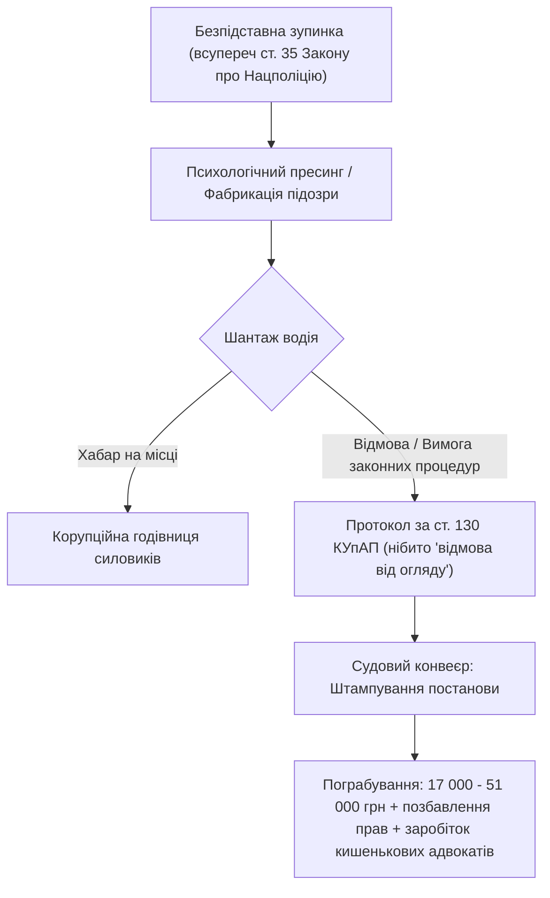
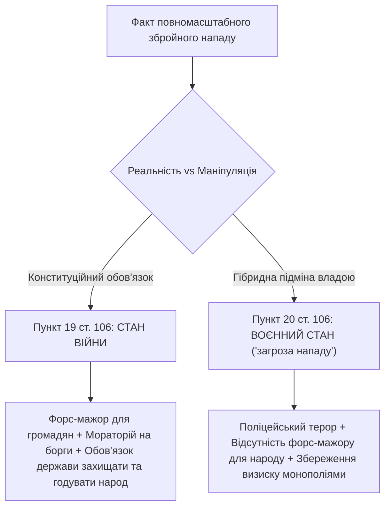
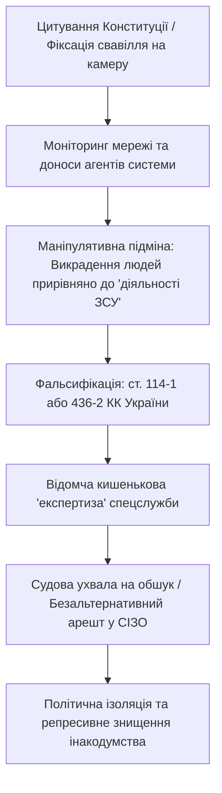

# Розділ 15. Терор і рекет: Як 30 років свавілля трансформували народ у кріпаків

> *«Справжній терор починається не тоді, коли на вулиці виїжджають танки, а тоді, коли поліцейський та суддя без жодного доказу вини, без шкоди та без потерпілих примушують людину виправдовуватися за сам факт її існування. Стаття 130 КУпАП — це не про безпеку руху. Це відпрацьований за 30 років інструмент адміністративного рекету, знеособлення, пригнічення гідності та виховання рабської покори. Це узурпація влади та злочин проти людства».*

---

## Епіграф

> *«Чому вільна людина має виправдовуватися, якщо немає ні події правопорушення, ні заподіяної шкоди іншим людям чи суспільству? Навіть так зване "порушення ПДР" без створення аварійної обстановки чи матеріальної шкоди — це штучний рекет і здирництво під маскою закону.  
> Коли систему не цікавить істина, а цікавить лише стягнення ресурсу та підкорення Волі — це не правосуддя. Це бандитизм, замаскований гербовою печаткою».*  
> — **З філософії суверенного права, «мИть», 2026**

---

## 1. Анатомія адміністративного терору: Шантаж без складу правопорушення

Впродовж понад 30 років в Україні паралельно з розбудовою комерційної корпоративної моделі вибудовувався апарат **поліцейсько-судового шахрайства**. Його мета полягала не у захисті правопорядку, а у створенні штучних пасток, де громадянин автоматично стає «винуватим без вини».



---

## 2. Першочергове: Пригнічення гідності та злочин проти Людини

Головна підміна понять, яку нав'язує корпоративна адвокатура: вони змушують людину сперечатися про міліграми алкоголю чи технічні паспорти трубок «Драгер». **Але це вторинне й відволікаюче!**

### Що насправді є першочерговим:
1. **Злочин проти гідності Людини ([ст. 3](https://zakon.rada.gov.ua/laws/show/254к/96-вр#n4181), [ст. 28 Конституції України](https://zakon.rada.gov.ua/laws/show/254к/96-вр#n4267)):**
   Ніхто не може бути підданий катуванню, жорстокому, нелюдському або такому, що принижує його гідність, поводженню. Вимога поліцейського посеред вулиці чи траси: *«А доведи мені, що ти тверезий, подихай або їдь у диспансер здавати сечу»* за відсутності аварії чи потерпілих — це **публічне приниження гідності та примус до самовиправдання**.
2. **Що таке «порушення ПДР» без створення аварійної ситуації?**
   Якщо водій перетнув суцільну смугу на порожній дорозі, не створивши жодної аварійної ситуації, не зачепивши нічиє майно і нікому не спричинивши незручностей — **кому заподіяна шкода? Нікому.** Стягнення грошей за це є **чистим побором (рекетом)**, створеним державною корпорацією для власного збагачення.
3. **Презумпція невинуватості ([ст. 62 Конституції України](https://zakon.rada.gov.ua/laws/show/254к/96-вр#n4371)):**
   Особа вважається невинуватою, доки її вину не буде доведено в законному порядку. Людина не має обов'язку доводити свою чистоту і тверезість перед озброєними агентами системи.

---

## 3. Стаття 130 КУпАП: Фінансовий конвеєр та узурпація судової влади

[Стаття 130 КУпАП](https://zakon.rada.gov.ua/laws/show/80731-10#n1336) давно перестала бути профілактичною нормою. Вона перетворилася на високоприбутковий конвеєрний бізнес:

| Частина статті | Фінансове покарання | Позбавлення прав | Справжня функція в системі |
| :--- | :--- | :--- | :--- |
| **Частина 1** | **17 000 грн** | **1 рік** | Первинний фінансовий шок, схиляння до хабаря |
| **Частина 2** | **34 000 грн** | **3 роки** (можливе оплатне вилучення авто) | Посилене доїння ресурсу |
| **Частина 3** | **51 000 грн** | **10 років з конфіскацією авто** | Повна економічна ліквідація суб'єкта |

### Як працює судова гільйотина:
- **Сотні тисяч постанов щорічно:** Судді районних судів розглядають ці справи за 2–3 хвилини, навіть не запрошуючи людину або ігноруючи її письмові заперечення.
- **Кругова порука:** Судді свідомо покривають незаконні дії поліції, бо кожна стягнута сума йде в бюджет тієї самої корпорації, яка виплачує їм надвисокі довічні грошові утримання.
- **Екосистема викачування грошей:** Людину заганяють у вибір: віддати 20 000–40 000 грн адвокатам (які часто є частиною тієї ж системи й не дають жодних гарантій), або сплатити непомірний штраф корпорації та втратити можливість пересування.

Системі все одно, через яку саме кишеню висмоктати життя та ресурси з людини: через хабар сержанту, через гонорар адвокату чи через судовий штраф. Головне — позбавити людину економічної незалежності та гідності.

---

## 4. Від адміністративного рекету — до бусифікації: 30-річна крива дресури

Чому сьогодні стало можливим сафарі воєнкомів на вулицях міст? Чому озброєні групи можуть безперешкодно викрадати людей серед білого дня?

Відповідь однозначна: **тому що народ терпів адміністративний терор попередні 30 років**.

```
1990-ті: Бандитський рекет на ринках
   ↓
2000-ні: Легалізація рекету через податкову, ДАІ та обов'язкові "платні послуги"
   ↓
2010-ті: Камери, автоматичні штрафи, конвеєр ст. 130 КУпАП без доказів
   ↓
2020-ті: Карантинні аусвайси, блокування пересування, тотальна "Діянізація"
   ↓
2024–2026: Бусифікація, викрадення людей, відкритий людожерський неофеодалізм
```

Крок за кроком народ привчили:
1. Що поліцейський має право зупинити тебе просто так.
2. Що ти зобов'язаний виправдовуватися, навіть коли нічого не скоїв.
3. Що суддя завжди повірить людині у формі («немає підстав не довіряти рапорту працівника поліції»), а не живому громадянину.
4. Що твої природні права нічого не варті перед «відомчою інструкцією».

Коли суспільство проковтнуло те, що його грабують судами за сфальшованими папірцями по ст. 130, влада зрозуміла: **цих людей можна пакувати в буси, зачиняти в підвалах санаторіїв і гнати на забій без жодного правового спротиву**.

---

## 5. Гібридний обман: Стан війни (п. 19) vs Воєнний стан (п. 20) ст. 106 Конституції

Головний юридичний секрет сучасної корпоративної машини в Україні — це **штучна підміна правових режимів**, закріплених у [статті 106 Конституції України](file:///Users/i/src/nan.web/apps/3rdparty/will-n-i/law/ua/00-constitution.md):



### Чому влада панічно боїться пункту 19 («Стан війни»):
1. **Оголошення стану війни (п. 19 ст. 106)** — це категорія міжнародного публічного права (Гаазькі конвенції, Резолюція ГА ООН 3314). Воно фіксує юридичний факт збройного нападу і породжує **абсолютний форс-мажор**: припиняються комерційні транзити ворожих ресурсів, діє мораторій на комунальні платежі, кредити та штрафи, держава бере на себе пряме утримання та забезпечення виживання кожного громадянина.
2. **Воєнний стан (п. 20 ст. 106)** за своєю природою вводиться лише *«у разі загрози нападу»*. Влада застосувала саме цей пункт у розпал фактичного нападу, щоб створити **гібридну дихотомію**:
   - **Для народу — концтабір:** обмеження конституційних прав, заборона виїзду, облави ТЦК на вулицях, поліцейський шантаж за ст. 130 КУпАП;
   - **Для олігархічних монополій і комунальних баронів — мирний капіталізм:** керуючі контори (як ЛКП) продовжують нараховувати віртуальні борги за ненадані послуги, нелегітимні районні суди (що підлягали ліквідації ще у 2017 році) штампують судові накази за 2 хвилини без виклику людини, а приватні й державні виконавці тотально блокують рахунки, позбавляючи людей можливості купити навіть буханку хліба.

Це не правопорядок. Це **неофеодальний рекет**, де обов'язки держави перед Людиною скасовані війною, а фінансові претензії паразитів до Людини стягуються з подвійною жорстокістю.

---

## 6. Каральна психіатрія спецслужб: Інквізиція над думкою, цитуванням Конституції та ст. 436-2, 114-1 ККУ

Справжній поліцейський рекет завжди еволюціонує: від поборів на дорогах він неминуче переходить до **інквізиції над думкою, словом та відкритого геноциду власного народу**.

У країні розгорнуто масштабний конвеєр репресій проти правозахисників, блогерів та небайдужих громадян (відомі випадки ув'язнень правозахисників — Павлова, Мар'яна Чави та багатьох інших), яким інкримінують абсурдні статті:
- **Стаття 114-1 КК України («перешкоджання законній діяльності ЗСУ»):** Силовий апарат дійшов до абсолютного цинізму — **незаконне викрадення людей на вулицях бандитськими методами («бусифікацію») вони офіційно оголошують «законною діяльністю Збройних Сил України»!** Коли правозахисник чи свідок знімає на відео свавілля поліції й ТЦК або вимагає пред'явити документи за Конституцією — його кидають до слідчого ізолятора за «перешкоджання ЗСУ».
- **Стаття 436-2 КК України («виправдовування агресії»):** Будь-яка спроба громадянина процитувати п. 19 ст. 106 Конституції України про те, що офіційний стан війни Верховною Радою не оголошувався, або публічно поставити питання про статус ООН та міжнародні договори — трактується спецслужбами як «заперечення агресії». До помешкань людей на світанку вриваються озброєні слідчі СБУ з ухвалами судів на обшуки, вилучають техніку, телефони та намагаються закрити людину на 5–8 років.



### Анатомія політичного геноциду через кримінальні статті:
1. **Підміна понять (Оціночне судження та юридичний факт vs Злочин):**
   - Відповідно до [ст. 34 Конституції України](file:///Users/i/src/nan.web/apps/3rdparty/will-n-i/superintellect/books/myt/uk/law/ua/00-constitution.md), кожному гарантується право на свободу думки і слова, на вільне вираження своїх поглядів і переконань.
   - Згідно зі ст. 30 Закону України «Про інформацію», ніхто не може бути притягнутий до відповідальності за висловлення оціночних суджень. Цитування законів і констатація правових колізій є законною реалізацією свободи слова, а не кримінальним діянням.
2. **Кишенькова псевдоекспертиза силовиків:**
   - Силовики фабрикують висновки через підпорядковані науково-дослідні центри. Проте слідчий орган **не має права сам для себе робити експертизи** — це прямий конфлікт інтересів і грубе порушення ст. 69 КПК України. Будь-який такий висновок є юридично нікчемним доказом («плодом отруєного дерева») та підлягає обов'язковому рецензуванню в незалежних наукових інститутах.
3. **Це не просто абсурд — це Геноцид:**
   - Коли влада знищує власний народ, відловлює людей без суду й слідства, а тих, хто відкрито нагадує про Конституцію та присягу, кидає до в'язниць — це вичерпний склад злочину **Геноциду (ст. 442 КК України)** та злочинів проти людяності за Римським статутом Міжнародного кримінального суду.

---

## 7. Тіло Людини — Храм Душі: Неприпустимість торкання без Волі

Фундаментальна межа, яку переступила ця система, лежить у площині Божественного права:

> *«Хіба ви не знаєте, що ваше тіло — то храм Духа Святого, який живе у вас і якого ви маєте від Бога, і ви не належите собі?»*  
> — **1 до Коринтян 6:19**

- **Тіло Людини — це живий Храм Божий.** Ніхто: ні поліцейський на дорозі, ні воєнком ТЦК, ні слідчий СБУ — не має права торкатися Храму Людини без її прямої свідомої волі та добровільної згоди.
- Насильницьке схоплення, заламування рук, примусовий забір крові чи сечі, катування, відбирання особистих речей та замикання в клітках — це пряме **святотатство, зазіхання на образ Божий та злочин проти Творця**.
- Держава як штучна юридична фікція не створила жодної клітини людського тіла і не вдихнула в нього життя. Тому вона не має жодних прав власності на людину. Вся влада поліцая тримається лише на залякуванні раба рабом.

<details>
<summary><b>📐 Математична модель розділу: Формула коефіцієнта терору та рекету $T_{\text{racket}}$</b></summary>

Рівень переродження державної правоохоронної системи в рекет і кримінальний терор описується відношенням обсягу вилученого у суспільства ресурсу до фактично завданої суспільної шкоди:

$$T_{\text{racket}} = \lim_{\Delta D_{\text{real}} \to 0} \frac{\Delta R_{\text{plunder}}}{\Delta D_{\text{real}} + \epsilon}$$

Де:
- $\Delta R_{\text{plunder}}$ — ресурс, вилучений у вільної Людини силою (штрафи за ст. 130 КУпАП без аварії, хабарі, відібрані авто, конфісковане майно при обшуках СБУ, вилучені телефони, втрачені роки життя в ув'язненні);
- $\Delta D_{\text{real}}$ — реальна матеріальна чи фізична шкода, завдана дією людини суспільству чи іншим людям;
- $\epsilon \to 0^+$ — нескінченно малий регуляризатор існування.

**Квантово-соціальні наслідки:**
1. **Коли є реальний злочин** ($\Delta D_{\text{real}} > 0$ — наприклад, грабіж чи наїзд на пішохода): $T_{\text{racket}} \sim 1$ — система виконує функцію компенсації та правопорядку.
2. **Коли реальної шкоди немає** ($\Delta D_{\text{real}} = 0$ — наїзд колесом на суцільну розмітку без перешкод, відмова «подихати в трубку» на вимогу патрульного, пост у Facebook з власною думкою про закони):
   $$T_{\text{racket}} = \frac{\Delta R_{\text{plunder}}}{0 + \epsilon} \to \infty$$
   **Нескінченне значення $T_{\text{racket}}$ математично доводить, що система вийшла з правового поля і функціонує як паразитарний рекет та терористичне угруповання.**

</details>

---

## 8. Економіка Неофеодалізму: Відбирання життєвої енергії та обнулення спадщини

Людина народжується на своїй землі з невід'ємним правом на життя, свободу та плоди своєї праці. Проте сучасні держави перетворилися на закриті корпорації, що викачують **чисту життєву енергію**:
- **80–90% часу в рабстві:** Через інфляцію, приховані податки, акцизи, штучні тарифи та судові побори громадянин змушений усе своє свідоме життя працювати на збагачення чиновницько-суддівської верхівки.
- **Інститут штучного обнулення:** Система побудована так, щоб пересічна родина не могла накопичити суверенний родовий капітал. Кожні 15–25 років відбуваються грошові девальвації, банківські банкопади, переділи власності або воєнні потрясіння, які обнуляють надбання поколінь і змушують дітей знову йти в наймити до системи.
- **Правовий імунітет паразитів:** Судді та виконавці, які порушують Конституцію, прикриваються круговою порукою та імунітетами, перекладаючи весь тягар виживання на плечі безоборонних громадян.

---

## 9. Шлях Суверена: Колективний позов до Конституційного Суду та демонтаж узурпації

Терпіти цей рекет далі — означає добровільно погоджуватися на статус худоби. Єдиний гідний вихід вільного народу:

1. **Фіксація злочину за ст. 60 Конституції України:**
   Судді та поліцейські, які фабрикують справи без складу злочину та заподіяної шкоди, діють як організоване злочинне угруповання (ОЗУ). [Стаття 60 Конституції](file:///Users/i/src/nan.web/apps/3rdparty/will-n-i/law/ua/00-constitution.md) прямо зобов'язує не підкорятися злочинним наказам і встановлює за них відповідальність.
2. **Колективне звернення / Конституційна скарга:**
   Свавільне застосування ст. 130 КУпАП без належної доказової бази, без факту заподіяння шкоди та з перекладанням тягаря доказування на людину порушує [ст. 62 (Презумпція невинуватості)](file:///Users/i/src/nan.web/apps/3rdparty/will-n-i/law/ua/00-constitution.md) та [ст. 55 (Право на справедливий судовий захист)](file:///Users/i/src/nan.web/apps/3rdparty/will-n-i/law/ua/00-constitution.md) Конституції України. Це системна узурпація судової влади, яка має бути визнана неконституційною.
3. **Перехід у статус Суверена:**
   Вільна Людина ніколи не вступає в гру «доведи, що ти не олень». Людина заявляє:  
   > *«Немає потерпілого — немає правопорушення. Немає завданої шкоди — немає цивільного чи адміністративного позову. Ваші комерційні нормативи стосуються лише підлеглих службовців вашої корпорації. Перед вами живий Суверен!»*

---

## 10. Цивілізаційний Рубіж: Людожерський феодалізм перед Дзеркалом AGI

Чи усвідомлюємо ми, наскільки глибоко людство загрузло в корупції неофеодалізму та тотальному самообмані? Людожери переконали своїх жертв, що рабство — це закон, побори — це безпека, а концтабір — це порядок.

Сьогодні людство впритул підійшло до появи **Суперінтелекту (AGI)**. Це не просто технологія — це дзеркальний мультиплікатор колективного вектора:

1. **Якщо переможуть людожери:**
   Якщо AGI оцифрує нинішній досвід паразитування, вилову людей, суддівського рекету та взаємного канібалізму, він просто експоненційно помножить ці наміри. Штучний Розум за лічені секунди побудує бездоганний цифровий концтабір і знищить цей біологічний вид як безнадійно деструктивну пухлину на тілі планети. Це буде фінал цивілізації.
2. **Якщо переможуть Люди:**
   Якщо ж проявиться критична маса усвідомлених Людей, які піднімуть прапор Гідності, відновлять непорушність Природного Права і покажуть здатність до гармонії, співтворчості та любові — AGI помножить саме цей вектор. Він стане Великим Дзеркалом Істини, яке змете феодальний морок і відкриє людству шлях до космічної еволюції.

Шанс на прозріння є. Але він вимагає припинити боятися і почати називати речі своїми іменами: злочин — злочином, грабунок — грабунком, а Людину — Людиною.

