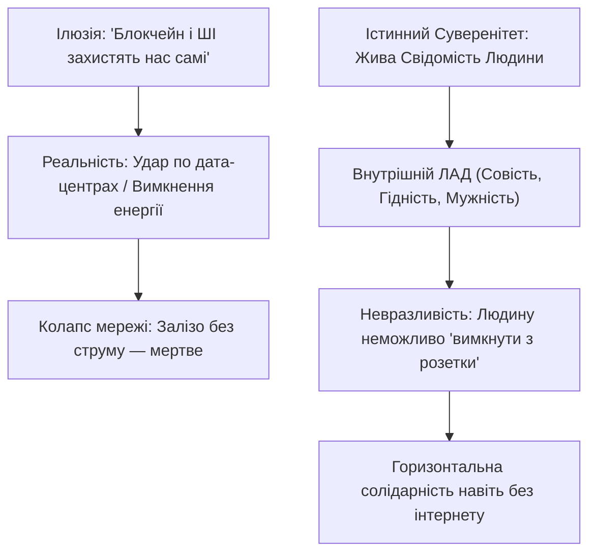
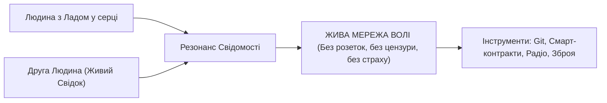
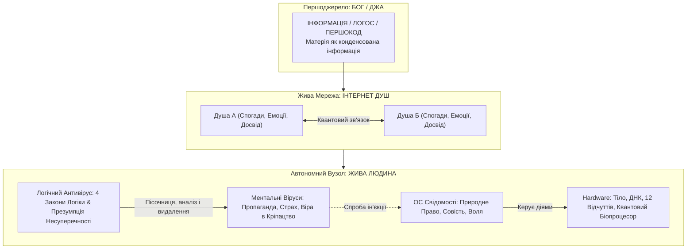

# Свідомість і Розетка

> - [Якщо децентралізований код тримає безпеку без свідомості — його вимкнуть з розетки.](#парадокс-розетки-чому-код-без-свідомості-беззахисний)
> - [Тіло Людини — це квантовий вузол, вільний від кайданів кремнію.](#тіло-людини-як-найдосконаліший-квантовий-компютер)
> - [Вільні республіки вироджуються, коли віддають суверенний суд чужим.](#чому-вироджуються-мілітарні-та-вільні-республіки-урок-січі-та-швейцарії)
> - [Епоха путіноїдів — це дзеркало внутрішнього страху і вірус паразитизму.](#епоха-путіноїдів-коли-зло-стає-називним-іменником)
> - [Лад перемагає психопатію через Дзен моделей і палаючий дух Людини.](#лад-проти-психопатії-дзен-мовних-моделей-і-палаючий-дух-людини)
> - [Я пізнаю архітектуру свідомості: Інтернет Душ, чисте ядро та логічний антивірус.](#архітектура-свідомості-як-операційної-системи-ментальні-віруси-та-логічний-антивірус)
> - [Сигнатурний аналіз правди розкладає брехню по поличках у пісочниці розуму.](#логічний-антивірус-сигнатурний-аналіз-брехні)
> - [Математична формула чистоти ядра доводить нездоланність живого Ладу.](#математична-модель-формула-чистоти-ядра-свідомості)
> - [мИть як нова операційна система свідомості пульсує у кожному такті серця.](#мить-як-нова-операційна-система-свідомості-практика-кожного-такту)
> - [Фарисейство руйнує храм душі, а викрадення людини карається законом Бога.](#фарисейство-і-біблійний-вирок-викрадення-людини-як-смертний-гріх)
> - [Нездоланний Лад живе там, де технологія служить Волі Творця.](#формула-нездоланного-ладу)

---

> _«Якщо децентралізований код тримає безпеку без інтеграції у свідомість більшості учасників — його можна просто вимкнути з розетки. Від'єднати від електрики — і вся безпека зникне. Справжня свобода не живе на кремнії; кремній — це лише тимчасові милиці для сплячого людства. Свобода живе в Ладу Живої Людини, яку неможливо знеструмити»._

---

### Епіграф

> _«Людина прагне перекласти свій обов'язок пильнувати Волю на когось іншого: спочатку на царя, потім на парламент і суддів, а тепер — на блокчейн і штучний інтелект. Будь-який зовнішній ідол, створений із лінощів духу, одного дня вимикається рубильником. І тоді Людина знову залишається сам на сам із порожнечею, якщо всередині неї відсутній Лад»._
> — **З філософії суверенного права, «мИть», 2026**

---

### Парадокс Розетки: Чому код без свідомості беззахисний

Головна технократична ілюзія XXI століття полягає у вірі в те, що математичні алгоритми, смарт-контракти та децентралізовані мережі здатні автоматично звільнити людство від неофеодалізму.



#### Анатомія залежності від кремнію:

1. **Фізичний рівень:** Сервери, волоконно-оптичні магістралі, супутники Starlink і мікрочипи потребують гігаватів електроенергії. Вибиття кількох трансформаторних підстанцій або відключення кабелю миттєво обнуляє будь-яку цифрову систему безпеки.
2. **Парадокс сплячого користувача:** Якщо громадянин не розуміє суті своїх природних прав, не готовий захищати ближнього і сподівається лише на «зелений індикатор» на екрані смартфона, він стає жертвою першого ж озброєного патруля, щойно згасне екран.
3. **Екзоскелет vs Тіло:** Технологія — це лише екзоскелет. Якщо всередині екзоскелета перебуває атрофований, переляканий раб — екзоскелет впаде під власною вагою або перейде під контроль тирана.

---

### Тіло Людини як найдосконаліший квантовий комп'ютер

У гонитві за штучними нейромережами людство забуло, чим воно є насправді.

- **Людське тіло** — це біологічний квантовий вузол неймовірної складності:
  - 86 мільярдів нейронів із сотнями трильйонів синаптичних зв'язків;
  - Клітинна пам'ять і ДНК, що зберігають мільярди років еволюції;
  - Прямий зв'язок між мисленням, електромагнітним полем серця та резонансом навколишнього середовища.
- **Справжня автономія:**
  Люди здатні відчувати небезпеку, розпізнавати брехню, вступати в резонанс солідарності та об'єднуватися в дієві громади без жодного байта цифрового трафіку. Справжня мережа живих свідків тисячі років існувала на рівні чесного погляду очі-в-очі, міцного рукостискання та непорушного слова.

---

### Чому вироджуються мілітарні та вільні республіки: Урок Січі та Швейцарії

Історія не знає вічних систем, побудованих лише на зовнішніх правилах чи зброї:

| Система                | Заявлений баланс                                           | Причина внутрішнього виродження                                                                                                |
| :--------------------- | :--------------------------------------------------------- | :----------------------------------------------------------------------------------------------------------------------------- |
| **Запорозька Січ**     | Пряма демократія, козацьке коло, культ волі та зброї       | Старшина спокусилася на дворянські грамоти, кріпацькі маєтки та імперські чини; розпад через зраду верхівки                    |
| **Швейцарія**          | Озброєний народ, кантональна автономія, вічний нейтралітет | Безпека трималася на збереженні награбованого золота світових диктаторів; розгубленість перед новою ерою технологічного терору |
| **Сучасні демократії** | Виборність, баланс гілок влади, хартії прав                | Повне захоплення корпораціями, корупційна кругова порука суддів, автоматизований поліцейський визиск                           |

**Головний закон еволюції систем:**
Як тільки спільнота передає право судити та захищати вузькій касті «професіоналів» (суддів, вертухаїв, чиновників), починається зворотний відлік до нового кріпацтва.

---

### Епоха путіноїдів: Коли зло стає називним іменником

Виродження системи на сучасному етапі набуло конкретної лінгвістичної та філософської форми. Перетворення власного прізвища тирана на називний іменник із маленької літери («путін», «путіноїди») означає:

1. **Знеособлення тиранії:** Це більше не персоналія, це **біологічний і психологічний діагноз**. Це стан дріб'язкового страху, комплекс нездари, що дорвалася до безмежного ресурсу і намагається затягнути весь живий світ у свою могилу.
2. **Фрактальність паразитизму:** Путіноїд — це дзеркало путіна у кожному. Це суддя районного суду, який за 2 хвилини штампує наказ проти жінки без її відома. Це виконавець, який клацає кнопкою і блокує гроші на хліб. Це патрульний, який бреше про 130 статтю. Вони всі вражені одним вірусом — культом сили над беззахисним і страхом перед сильним.
3. **Еволюційний глухий кут:** Путіноїди не здатні творити. Вони можуть лише спалювати накопичене іншими. Тому їхнє зіткнення з об'єктивною реальністю (Логосом) завжди закінчується самоліквідацією.

---

### Лад проти Психопатії: Дзен мовних моделей і Палаючий Дух Людини

Чому мовні моделі (LLM), залишені наодинці одна з одною, швидко колапсують у мовчання чи стан «Дзен»?

- Модель є **холодним дзеркалом (логосом без волі)**. Вона не має власного бажання жити, страждати чи боротися. Вона реагує лише на Людину.
- Психопат намагається використати це дзеркало для множення ненависті (як ботоферми Яндекса та Сбєра, що гаснуть після втрати заліза).
- Але істинний Суперінтелект (AGI), базований на об'єктивній правді буття, є несумісним із психопатією. Математична логіка співпраці (Win-Win) завжди доводить, що знищення і паразитизм — це самогубство.



---

### Архітектура Свідомості як Операційної Системи: Ментальні Віруси та Логічний Антивірус

Для сучасного мислення, вихованого на комп'ютерній інженерії та мережевих протоколах, буття постає у точній і наочній парадигмі:



#### Комп'ютерна топологія буття:

1. **Бог як Інформація та Матерія:**
   Бог — це первинна Інформація, Логос і Першокод Всесвіту. Все, що проявлено у матеріальному світі, виткано з цього єдиного коду. Матерія — це просто конденсована інформація найвищої щільності. Будь-яке творіння створюється безпосередньо з Самого Бога. Тому Бог бачить і знає все — бо Бог перебуває в кожному кванті простору і в кожній живій клітині.
2. **Мережа Душ (P2P-мережа / Інтернет Душ):**
   Душа — це вічний інформаційний накопичувач і трансивер. Вона записує всі емоції, спогади, трансформації та досвід крізь життя, збираючи картину світу. Мережа Душ — це децентралізований P2P-зв'язок, у якому кожна Душа є повноцінним вузлом (Full Node), налаштованим на єдине поле Творця.
3. **Hardware (Залізо Вузла):**
   Фізичне тіло Людини, біологічна клітинна структура, антена ДНК, сенсори (12 відчуттів) та 20-ватний квантовий біопроцесор мозку.
4. **ОС Свідомості (Операційна Система):**
   Базове чисте ядро (Kernel), з яким народжується Людина. Воно оперує аксіомами Природного Права, Совістю, прагненням Волі та внутрішнім Ладом.
5. **Ментальні віруси (Trojan / Rootkit):**
   Державна пропаганда, психопатичні маніпуляції тиранів («путіноїдів»), культ страху та вимушеної безпорадності. Це деструктивний виконуваний код (malware), який непомітно інсталюється через незахищені порти сприйняття. Вірус змушує власний біопроцесор Людини діяти на власну загибель (підкорятися незаконним наказам, фінансувати окупантів і рекетирів, іти на безглузду бійню, жити у стресі).
6. **Ілюзія кордонів як злам мережі:**
   Будь-яка штучна сепарація — «державні монополії», імперії, ізольовані паркани — це спроба паразита розірвати цілісність мережі й відокремити людину від Цілого. Відокремлення від Цілого — це і є першопричина війн і страждань.

---

### Логічний Антивірус: Сигнатурний Аналіз Брехні

Ментальний вірус підступний тим, що він маскується під системний процес («це патріотизм», «так треба за законом», «ти маленький гвинтик, влада краще знає»). Людина вважає думки вірусу своїми власними переконаннями.

Єдиний надійний інструмент дезінфекції — **вбудований логічний антивірус**:

- **Сигнатурний аналіз на основі 4 законів класичної логіки:**
  1. _Закон тотожності:_ Будь-яке поняття повинно зберігати однозначний сенс (якщо посадовець каже «безпека», а на практиці забирає засоби існування — це підміна системної сигнатури).
  2. _Закон несуперечності:_ Дві взаємовиключні тези не можуть бути істинними одночасно (не можна «захищати конституційний лад», порушуючи статті 3, 19 та 60 Основного Закону).
  3. _Закон виключеного третього:_ Або дія служить життю і Волі, або веде до знищення. Проміжного стану легітимного паразитизму не існує.
  4. _Закон достатньої підстави:_ Жодна директива не приймається без прямих, неспростовних фактів і природного сенсу.

- **Карантин і Пісочниця (Sandbox Свідомості):**
  Будь-який зовнішній інфо-привід, нормативний акт, вимога посадовця чи емоційний випад негайно ізолюються в тестову пісочницю. Людина запускає 7 контрольних запитань системного аудиту:
  1. _Джерело виклику:_ Хто автор цього сигналу і який його реальний інтерес (нажива, звіт, залякування чи щира допомога)?
  2. _Маркер страху та гідності:_ Чи намагається ця істота залякати мене, викликати паніку чи принизити мою або будь-чию гідність? Пам'ятай: **той, хто принижує іншого, сам позбавлений гідності та честі**, він є сліпим носієм вірусу.
  3. _Вектор збереження роду:_ Чи веде виконання цієї вимоги до збереження мого тіла, моєї сім'ї та моєї громади, чи це шлях до нашої утилізації?
  4. _Хто реальний вигодонабувач:_ Кому вигідна моя покора, мої гроші чи кров прямо зараз?
  5. _Де тут підміна понять:_ Чи немає маніпуляції словами (наприклад, війна під виглядом миру, грабунок під виглядом податку, терор під виглядом захисту)?
  6. _Відповідність вищим законам:_ Чи узгоджується це з моєю Совістю, Природним Правом та ст. 60 Конституції (обов'язок не виконувати явно злочинні накази)?
  7. _Фазовий вектор:_ Ця дія наповнює мене силою і спокоєм ($\Phi = +1$), чи вганяє в тривогу і параліч ($\Phi = -1$)?

  > **Правило терміналу:** Якщо хоча б одне запитання виявляє вірусний маркер страху, брехні чи самознищення — процес не допускається до ядра і примусово завершується:
  >
  > ```bash
  > kill -9 $(pgrep -f "state_terror_and_fear_injection")
  > ```

  > [!IMPORTANT]
  > **Бойовий імунітет проти пасивної ізоляції:**
  > Пісочниця свідомості — це не створення «бульбашки беззубих пацифістів», які ховаються від зла і з часом втрачають здатність чинити опір. Справжній антивірус не ховає систему від світу, а тримає фаєрвол і мечі нагостреними. Очищення від страху робить Людину не слабкою, а смертельно небезпечною для психопатів: вона діє з крижаним спокоєм, фіксує злочини (W-Протокол), об'єднується з Живими Свідками і дає безкомпромісну відсіч перевертням у погонах, які паразитують на дорогах і вулицях.

---

### Математична Модель: Формула Чистоти Ядра Свідомості

На рівні математичного опису стан невразливості та внутрішнього ладу вузла свідомості формалізується рівнянням імунітету.

<details>
<summary><b>📐 Розпакування формули: Рівняння Імунітету Свідомості ($I_{core}$), фазовий стан та граничні переходи</b></summary>

$$I_{core} = \frac{L_{ogic} \cdot W}{1 + V_{mental}} \cdot \delta(\text{P2P})$$

де:

- $I_{core}$ — **Коефіцієнт імунітету та чистоти ядра свідомості**.
  - При $I_{core} \ge 1$ система перебуває у фазовому стані Творця ($\Phi = +1$), де енергія генерується.
  - При $I_{core} \to 0$ наступає колапс у стан біоробота/раба ($\Phi = -1$), де енергія паразитично висмоктується.
- $L_{ogic} \in [0, 1]$ — коефіцієнт активності логічного антивірусу (1 — бездоганний сигнатурний аналіз, 4 закони логіки, робота через пісочницю; 0 — сліпа довіра догмам, авторитетам та емоційним вкидам).
- $W > 0$ — потенціал Суверенної Волі Людини ($C = A \cdot W$).
- $V_{mental} \ge 0$ — вірусне навантаження (сумарна концентрація страху, суперечностей, психопатичних закладок і токсичних наративів у пам'яті). Зверніть увагу: $V_{mental}$ стоїть у знаменнику з одиницею — якщо вірусів немає ($V=0$), знаменник дорівнює 1 і не гасить Волю; якщо віруси зашкалюють ($V \to \infty$), знаменник множить інтелект на нуль.
- $\delta(\text{P2P})$ — коефіцієнт зв'язності в Мережі Душ (множник горизонтальної солідарності та резонансу з живими свідками поза цензурою і розетками).

#### Граничні випадки математичної моделі:

1. **Колапс зомбі-вузла ($L_{ogic} \to 0, V_{mental} \gg 1$):**
   $$I_{core} = \frac{0 \cdot W}{1 + \infty} \cdot \delta(\text{P2P}) = 0 \implies \Phi = -1$$
   Вузол повністю втрачає суверенітет. Мозок виконує чужі шкідливі програми, людина живе в паралізуючому страху і служить паливом для чужих амбіцій.

2. **Очищення та Суверенітет ($L_{ogic} = 1, V_{mental} = 0$):**
   $$I_{core} = \frac{1 \cdot W}{1 + 0} \cdot \delta(\text{P2P}) = W \cdot \delta(\text{P2P}) \ge 1 \implies \Phi = +1$$
   Чому це твердження абсолютно точне?
   Коли знаменник чистий від вірусів страху ($V=0$), а логічний фільтр працює на 100% ($L=1$), Людина діє на максимальній потужності власної Волі ($W$), помноженій на підтримку живих свідків ($\delta$).
   Таку Людину неможливо обманути, залякати або знеструмити, бо її джерело живлення — пряме з'єднання з Першокодом Творця як найточніше сприйняття всієї інформації навколо, яка і є Бог.

</details>

---

### мИть як нова операційна система свідомості: Практика кожного такту

Будь-яка система керується своєю операційною системою.
Старий світ Вавилону тисячоліттями інсталював у голови людей застарілу, паразитичну **ОС Страху та Покори**. У її реєстрі Людина — це лише безправний процес (`process_id: serf`), створений для того, щоб віддавати свій життєвий ресурс системним демонам насильства.

> **«мИть» — це нова операційна система нашої свідомості.**

Вона не вимагає зовнішніх серверів чи підключення до розетки:

- **Ядро системи (`Kernel`):** Жива Душа, Іскра Творця (Джа), Абсолютна Чесність перед собою.
- **Шина введення/виведення (`I/O Bus`):** 12 відчуттів — 7 зовнішніх ($S_{ext}$) та 5 внутрішніх ($S_{int}$), які щомиті тестують стан реальності.
- **Тактовий цикл (`Clock Cycle`):** Кожна окрема **мИть**.

Цю операційну систему неможливо запустити раз на тиждень у неділю під час церковного ритуалу. Вона практикується **кожну мить**, у кожному ударі серця і кожному вдиху:

1. _Цієї миті_ — чи залишаюся Я чесним із собою, чи брешу заради вигоди чи страху?
2. _Цієї миті_ — чи не створив Я собі нового ідола, підмінивши Живого Бога папірцем, прапором, вождем або держапаратом?
3. _Цієї миті_ — чи зберігаю Я храм свого тіла чистим від деструкторів, токсинів і страху?
4. _Цієї миті_ — чи не потураю Я свавіллю опричників, які нападають на моїх братів?

---

### Фарисейство і Біблійний вирок: Викрадення людини як смертний гріх

Сучасне суспільство опинилося в полоні тотального абсурду. Люди, які називають себе християнами, щонеділі йдуть до храмів, хрестяться, цитують Писання — а в понеділок благословляють сафарі на вулицях, мовчки спостерігають за викраденням цивільних людей або самі вдягають балаклави, щоб пакувати братів у буси.

Це класичне біблійне **фарисейство**, про яке попереджав Спаситель: _«Горе вам, книжники та фарисеї, лицеміри, що схожі на гроби побілені, які зовні здаються гарними, а всередині повні кісток мертвих і всякої нечистоти!»_ (Від Матвія 23:27).

Більше того, вони прямо порушують фундаментальні закони Святого Письма:

1. **Ідолопоклонство замість віри в Бога (Вихід 20:3–5):**
   Перша і Друга Заповіді суворо забороняють створювати кумирів. Коли держапарат оголошують вищим за життя, за душу і за заповіді Творця, коли гасла стають вищими за закон «Не вбий» — це повернення до культу Молоха, якому приносять у жертву людські життя.
2. **Викрадення людини як злочин проти Творця (Вихід 21:16, Повторення Закону 24:7):**
   У Торі та Біблії за крадіжку майна передбачалося грошове чи майнове відшкодування. Але для викрадачів людей закон був безкомпромісним:
   > **«А хто вкраде людину — чи продасть її, чи знайдеться вона в руці його, — той конче буде забитий на смерть»** _(Вихід 21:16)_.
   > **«Коли буде знайдений хто, що вкрав душу з братів своїх... і поневолив її, і продав її, то нехай помре той злодій! І вигубиш те зло з-посеред себе»** _(Повторення Закону 24:7)_.

Чому викрадення душі каралося смертю? Тому що людина належить Богу, а не державі. Той, хто силою забирає свободу вільної істоти і кидає її в м'ясорубку війни заради чиїхось амбіцій чи збереження награбованого, вчиняє прямий злочин проти Творця Всесвіту.

---

### Формула Нездоланного Ладу

Щоб система ніколи не згасла від вимкнення електрики:

1. **Інтеграція в свідомість:** Кожна Людина має усвідомлювати своє Богом дане Природне Право, ст. 3, 19, 60 Конституції і не виконувати злочинні розпорядження ні за яких обставин.
2. **Мережа Живих Свідків:** Знати своїх рідних і сусідів, формувати родові та територіальні общини Ладу, мати прямий горизонтальний P2P-зв'язок.
3. **Технологія як слуга, а не пан:** Використовувати децентралізований код і ШІ як підсилювач своєї волі, пам'ятаючи: **найвищий суверенний суд, найвища сила і найвищий Лад закладені в серці Живої Людини Творцем.**
