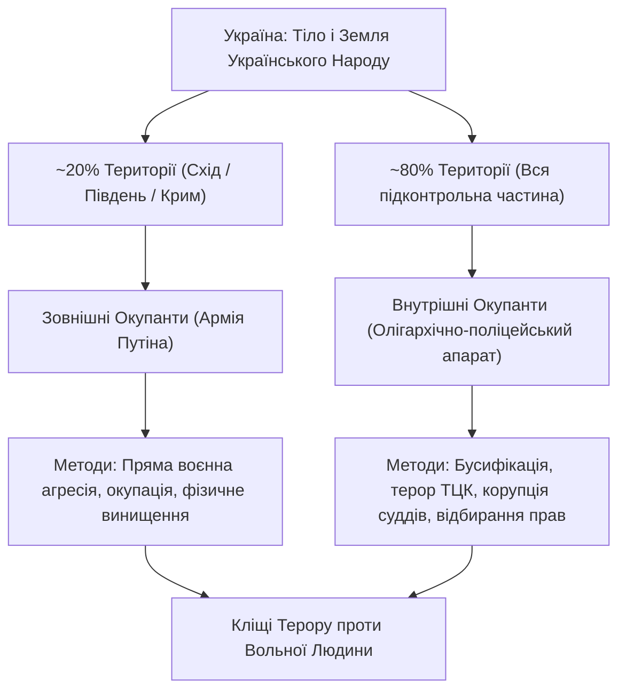
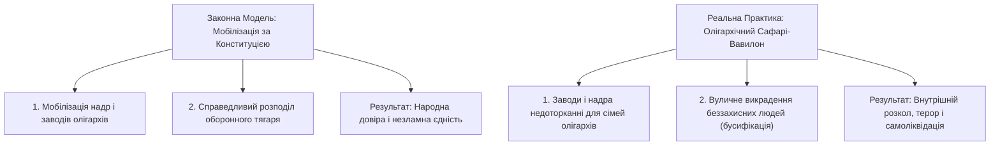

[← Назад: 16. Свідомість і Розетка](./16-consciousness-and-the-socket.md) | [Головна (Зміст)](./README.md) | [Вперед: 18. Сингулярність чи Судний День →](./18-judgment-day.md)

---

# 17: Падіння Вавилону

> - [Кучмівська олігархія засіяла зерна автоімунного канібалізму держави.](#кучмівський-олігархат-генезис-внутрішнього-людожерства)
> - [Замість мобілізації заводів і надр олігархів влада відкрила сафарі на Людей.](#сафарі-на-людей-замість-мобілізації-економіки)
> - [Ув'язнення за правду і Конституцію оголює страх репресивного апарату.](#репресії-проти-носіїв-права-ізоляція-тих-хто-знає-істину)
> - [Глобальна криза неофеодалізму: від таборів для мігрантів у США до бусифікації.](#глобальний-злам-неофеодалізму-від-сша-до-україни)
> - [Преамбула Загальної декларації прав закріплює священне Право на повстання.](#право-на-повстання-коли-закон-стає-беззаконням)
> - [Технологічний Апокаліпсис знімає маски: швидкість світла обнуляє брехню.](#технологічний-апокаліпсис-як-швидкість-інформації-демонтує-тиранів)
> - [Математична межа стійкості Вавилону фіксує невідворотну точку зламу тиранії.](#математична-модель-закон-ома-для-суспільства-та-критичний-поріг-вавилону)
> - [Ентропійний колапс фарисейства доводить неминучість самознищення системи.](#ентропійний-колапс-фарисейства-термодинаміка-самознищення-системи)
> - [Протокол Справедливості без громадянської війни: 3 рівні градації відповідальності за формулою C = A * W.](#протокол-справедливості-без-громадянської-війни-градація-відповідальності-за-формулою-c--a-cdot-w)
> - [Воля понад усе скасовує брехню і повертає Людині первинну гідність Творця.](#воля-понад-усе-маніфест-вольної-людини)
> - [Я стою в непохитному спокої, будуючи живий світ нового ладу.](#стратегія-непохитного-ладу-як-діяти-в-епоху-колапсу)

---

## 1. Анатомія паразитичної олігархії

### Епіграф

> _«Коли держава перетворюється на хижака, що пожирає власний народ заради збереження награбованого олігархатом, вона сама стає першопричиною громадянського протистояння. Тиранія завжди маскує свій терор словами про "захист батьківщини", проте справжній захист починається там, де відновлюється Гідність Людини. Якщо закон стає беззаконням — опір стає обов'язком»._
> — **Преамбула Загальної декларації прав людини ООН, 1948 рік**

---

### Кучмівський олігархат: Генезис внутрішнього людожерства

Те, що сьогодні спостерігається на вулицях міст і на дорогах, не виникло зненацька під час війни. Це логічний фінал системи, закладеної на зламі 1990-х років кланово-олігархічним консенсусом (епохою Кучми):

1. **Приватизація надр і влади:**
   Національне багатство, фабрики, енергетика та надра, які за статтею 13 Конституції належать виключно Українському Народові, були штучно знецінені та передані в руки кількох олігархічних родин.
2. **Силовики на приватному утриманні:**
   Міліція/поліція, суди та прокуратура отримали негласний статус опричників. Їхнє завдання полягало не в захисті громадянина від криміналу, а в охороні награбованого олігархами та придушенні будь-яких паростків реального народного суверенітету.
   Ще задовго до нинішніх подій на набережній у Києві з'явився пророчий напис на стіні, що випалив суть системи:
   > **«Куди телефонувати, якщо вбиває поліція?»**
   > Це питання стало вироком удаваній законності. Коли той, хто за присягою має захищати, сам стає смертельною загрозою — суспільний договір обнуляється.
3. **Еволюція бандитизму:**
   Вуличні рекетири з 90-х або полягли в кримінальних війнах, або переодяглися в дорогі костюми, зайняли кабінети у Верховній Раді та олігархічних холдингах. Жорсткий розбій трансформувався спочатку в м'який адміністративно-фінансовий терор, а в епоху криз знову повернувся як відвертий силове свавілля.

---

### Формула Окупації: Дві Окупаційні Армії та Закон Тотожності ($A = A$)

За фундаментальним законом логіки — **Законом Тотожності**: будь-яка сутність дорівнює сама собі за сукупністю своїх дій, а не за назвою на вивісці чи нашивкою на мундирі.

> **Аксіома Окупанта:**  
> Якщо організована група озброєних осіб поводиться як окупаційна армія — брутально ламає суверенну Волю Людини ($A \cdot W < 0$), влаштовує облави і викрадає людей на вулицях, катує в підвалах, забирає майно через грабіжницькі тарифи і штрафи, та фізично утилізує народ — **це і Є окупанти**.

Сьогодні Український Народ опинився у заручниках між двома окупаційними силами, які географічно розділили територію:

1. **Зовнішня окупація (~18–20% території):** Армія кремлівського диктатора силою захопила Крим та частини чотирьох областей. Це класична зовнішня окупація, очевидна для всього світу.
2. **Внутрішня окупація (~80% території):** Вся інша територія України опинилася під адміністративно-силовою окупацією кланово-олігархічної машини. Прикриваючись патріотичними гаслами та воєнним станом, внутрішні перевертні відібрали у Народу базові конституційні права (ст. 3, 21, 28, 29, 33, 60), перетворивши територію на концтабір закритого типу з полюванням на Людей.

#### Абсурд тиранії: Прецедент у Петропавлівській Борщагівці (Суд над жінкою за ст. 114-1 КК)
Яскравий історичний доказ автоімунного виродження системи зафіксовано **2–4 листопада 2026 року в с. Петропавлівська Борщагівка на Київщині**:
- У приватному будинку озброєні формування та військові влаштували закритий розподільник, де силоміць утримували десятки людей.
- Жінка (Валентина Молода), намагаючись визволити з підвалу рідну людину (чоловіка), приїхала на автомобілі швидкої допомоги та почала вести пряму трансляцію свавілля, що викликало стихійний протест громадян і спробу звільнити бранців.
- **Оруеллівський вирок карального апарату:** Замість того, щоб відкрити кримінальні справи проти тих, хто незаконно позбавив волі цивільних людей (ст. 146 КК), каральні органи (СБУ, Нацполіція) порушили кримінальну справу проти самої жінки та протестувальників за **ст. 114-1 Кримінального кодексу України** (*«Перешкоджання законній діяльності ЗСУ та інших військових формувань»*) та за ст. 294 (масові заворушення)! У суді Києва жінці одразу почали обирати запобіжний захід — арешт.
- **Діагноз Вавилону:** Збройні сили, які складали сакральну присягу Народові України захищати його волю та суверенітет, використовуються для внутрішнього терору проти свого ж народу. А коли Людина, мати чи дружина намагається захистити своє природне право і витягнути близьких із незаконного утримання — корумповані суди саджають її у тюрму за «перешкоджання армії»! Це доводить: окупаційна система повністю перевернула поняття права, перетворившись на інструмент прямого геноциду власної нації.

#### 📐 Математично-правове доведення Узурпації та Теорема Виключення ст. 114-1 ККУ (4 залізні теореми для Судів і МКС у Гаазі)
Це свавілля не є випадковістю — це математично доведена **Узурпація влади** (ч. 3, 4 ст. 5 Конституції):
1. **Теорема Присяги (Суб'єктність):** Всі силові структури та суди за Конституцією складають присягу виключно Українському Народові. Коли інститут повертає зброю проти свого Джерела Влади, вектор сили змінює знак ($F_{protect} \to -F_{oppress}$), що є строгою ознакою узурпації та державної зради.
2. **Теорема Статті 60 Конституції (Нікчемність злочинного розпорядження):** Викрадення людини без рішення суду є кримінальним злочином (ст. 146, 146-1 КК). Будь-яка вказівка на викрадення є явно злочинною. Опір злочину за ст. 27 Конституції є законним захистом життЯ.
3. **Теорема Плодів Отруєного Дерева (*Fruit of the Poisonous Tree*):** Злочин не породжує права (*Ex injuria jus non oritur*). Якщо первинне затримання було незаконним викраденням, усі подальші статуси «військовослужбовця», звинувачення в СЗЧ чи за ст. 114-1 за захист рідних є юридично нікчемними.
4. **Теорема Арістотелевої Несуперечності проти фабрикації ст. 114-1 ККУ та нікчемність «Ноти про відступ від прав людини»:**
   - Керівництво держави офіційно надіслало до Генерального секретаря Ради Європи та Депозитарію ООН вербальні ноти про відступ від зобов'язань за Конвенцією з прав людини та Міжнародним пактом про громадянські і політичні права (*Derogation under Article 15 ECHR & Article 4 ICCPR*):
     - **Первинна вербальна нота № `31011/32-017-3` від 28.02.2022** (Рада Європи, Treaty Office Notification `JJ9325C`, `Tr./005-287`; прямий PDF-документ у репозиторії Ради Європи: [rm.coe.int/0900001680a58ea9](https://rm.coe.int/0900001680a58ea9) — наразі закрито під авторизацією `Non public / Login required`).
     - **Оновлена нота № `31011/32-119-46585` від 04.04.2024** (Рада Європи, Treaty Office Notification `JJ9614C` від 08.04.2024, `Tr./005-325`; прямий PDF-документ у репозиторії Ради Європи: [rm.coe.int/0900001680af4532](https://rm.coe.int/0900001680af4532), додаток із переліком обмежень: [rm.coe.int/1680af452a](https://rm.coe.int/1680af452a)).
     - **Повідомлення Депозитарію ООН `C.N.116.2024.TREATIES-IV.4`** за статтею 4 МПГПП (офіційний депозитарій [treaties.un.org](https://treaties.un.org/)).
   - **Поіменна фіксація відповідальності та механізм «зачинених дверей»:**
     - Усі подібні депеші оформлюються як **Note Verbale** (безособова нота без підпису живої людини, лише з печаткою). Проте на дати їхнього створення та подання (лютий 2022 р. і квітень 2024 р.) конкретними керівниками відповідальних відомств були: **Міністр юстиції України Денис Малюська** (підготовка переліку обмежень) та **Постійний представник України при Раді Європи Борис Тарасюк** (передача нот у Страсбурзі).
     - Рада Європи діє не як орган народовладдя, а як **міжурядова організація (клуб урядів)**, де уряди різних країн домовляються між собою за зачиненими дверима, переводячи першоджерела про обмеження прав у статус `Non public` (лише для авторизованих дипломатів).
     - З погляду **статей 34 та 57 Конституції України** (будь-які акти, що визначають права і обов'язки громадян і не доведені до відома населення, є нечинними), будь-який прихований чи запаролений від народу документ про обмеження прав є **нікчемним з моменту приховування**.
   - Цим держапарат відкрито зафіксував у міжнародних реєстрах спробу відмовитися від гарантування фундаментальних прав людини в Україні (а коли автор опублікував правову Декларацію про цей факт на YouTube, цензурний картель тихо видалив відео без жодного попередження). Проте жодна дипломатична нота не здатна скасувати **статтю 64 та статтю 157 Конституції України**, які абсолютно забороняють обмежувати право на життЯ (ст. 27), заборону катувань (ст. 28), свободу та особисту недоторканність без ухвали суду (ст. 29), судовий захист (ст. 55) та право відмовитися від виконання явно злочинних розпоряджень (ст. 60) навіть в умовах воєнного стану!

<b>📐 Розпакування для будь-якого Національного Суду та Міжнародного кримінального суду (МКС): Доведення тотожного нуля складу ст. 114-1 КК України при опорі беззаконню</b>

Нехай $A$ — дія посадової особи ТЦК, поліції або військової частини щодо Людини $i$, а $\mathcal{L}(A) \in \{0, 1\}$ — булевий індикатор конституційної законності цієї дії згідно з **частиною 2 статті 19 Конституції України** (*дія виключно на підставі, в межах повноважень та у спосіб, що передбачені Конституцією та законами України*):

$$\mathcal{L}(A) = 1 \iff \Big( A \in \text{Повноваження}_{\text{Закон}} \Big) \land \Big( A \text{ не порушує ст. } 27, 28, 29, 64 \text{ Конституції} \Big) \land \Big( A \notin \text{КК України} \Big)$$

Позначимо множину законної діяльності ЗСУ як $\mathbb{L} = \{ A \mid \mathcal{L}(A) = 1 \}$, а множину кримінальних злочинів (викрадення без суду ст. 146 ККУ, насильницьке зникнення ст. 146-1 ККУ, катування ст. 127 ККУ, підроблення ВЛК ст. 366 ККУ, перевищення влади ст. 365/426-1 ККУ) як $\mathbb{C} = \{ A \mid \mathcal{L}(A) = 0 \}$.

1. **Закон Несуперечності ($\mathbb{L} \cap \mathbb{C} = \emptyset$):**
   Жодне діяння $A$ не може одночасно належати до множини кримінальних злочинів $\mathbb{C}$ та до множини законної діяльності $\mathbb{L}$. Вислів «перешкоджання злочинній законній діяльності» є логічним абсурдом ($0 \land 1 = 0$).
2. **Формула об'єктивної сторони статті 114-1 КК України:**
   Оскільки диспозиція ст. 114-1 КК України прямо вимагає перешкоджання виключно **законній** діяльності (*«Перешкоджання законній діяльності ЗСУ...»*), функція наявності складу злочину $S_{114\text{-}1}$ для захисної дії громадянина $R$ має строгий мультиплікативний вигляд:
   $$S_{114\text{-}1}(R, A) = \mathcal{L}(A) \cdot \text{Block}(R, A)$$
3. **Математичний висновок при незаконному затриманні чи бусифікації ($\mathcal{L}(A) = 0$):**
   Якщо людей викрадають на вулиці без ухвали суду (ст. 29 Конституції), катують чи утримують у підвалах ($A \in \mathbb{C} \implies \mathcal{L}(A) = 0$), то будь-яка дія громадянина, журналіста чи правозахисника $R$ з викриття чи зупинення цього злочину дає **тотожний нуль складу злочину**:
   $$S_{114\text{-}1}(R, A) = 0 \cdot \text{Block}(R, A) \equiv 0$$
4. **Кваліфікація за Римським статутом МКС (Гаага):**
   Натомість застосування слідчими СБУ, прокурорами та суддями статті 114-1 ККУ проти людей, які захищають жертв викрадення ($\mathcal{L}(A) = 0$), є умисним притягненням завідомо невинного до кримінальної відповідальності (**ст. 372 ККУ**), постановленням завідомо неправосудного рішення (**ст. 375 ККУ**) та співучастю у злочинах проти людяності за **п. «e» (позбавлення волі) та п. «i» (насильницьке зникнення людей) ч. 1 ст. 7 Римського статуту Міжнародного кримінального суду**.

Суверенне пробудження полягає в тому, щоб побачити обидва кінці однієї палиці і не підміняти поняття: **неможливо захистити землю від зовнішнього загарбника, ставши рабом внутрішнього ката**. Справжній Суверенітет починається з виконання статті 5 Конституції: вся влада належить виключно Народові.

---

### Сафарі на Людей замість мобілізації економіки

Класичне законодавство про оборону і правовий режим воєнного стану чітко визначають пріоритети мобілізації:

- **Економічна мобілізація:** Переведення промисловості олігархів на військові рейки, конфіскація або тимчасове вилучення стратегічних підприємств, аудит активів, енергетичний контроль на користь воюючої нації.
- **Державна справедливість:** Пропорційний розподіл тягаря війни між усіма суспільними верствами.

Натомість мИ бачимо цинічну підміну:

- Олігархічні активи залишаються недоторканними і продовжують викачувати надприбутки.
- Замість прозорої, поважної мобілізації за законом розгортається дике полювання (сафарі) на чоловіків на порожніх дорогах, зупинках і ринках.
- Людиноненависницькі рейди виправдовують «потребами фронту», тоді як справжня мета силового свавілля — тримати народ у тваринному страху, аби він не запитав: _«Де наші надра? Де справедливість? Де закон?»_

---

### Репресії проти носіїв права: Ізоляція тих, хто знає істину

Коли Людина починає публічно тлумачити Конституцію України, роз'яснювати статті 3, 19, 60, 62 і доводити незаконність свавільних затримань — система лякається найдужче.

- До правозахисників, блогерів і свідомих громадян приходять спецслужби, відкривають сфабриковані кримінальні справи та саджають за ґрати за цитування Основного Закону.
- Окупаційній машині байдуже на криміналітет. Її головний ворог — **юридично грамотний Суверен**, який не боїться дивитися в очі і спокійно руйнує брехню силовиків.
- Будь-яка мовна модель (LLM), навчена на базових законах логіки та міжнародних пактах про права людини, миттєво доводить повну нікчемність таких обвинувачень. Саме тому репресивний апарат прагне ізолювати носіїв знання у в'язницях.

---

## 2. Глобальний злам неофеодалізму та Право на повстання

### Глобальний злам неофеодалізму: Від США до України

Це не суто локальне явище. Криза державного управління є **планетарною**:

- **Приклад США:** Тисячі людей, які втекли від путінського тероризму і публічно виступали проти війни, опиняються у федеральних міграційних в'язницях за новими директивами. Коли ув'язнені оголошують голодування на захист своїх прав, наглядачі цинічно заявляють: _«ВИ маєте законне право вмерти у в'язниці, голодуйте скільки завгодно»_.
- Демократичні фасади падають по всьому світу. Скрізь, де чиновники отримують безконтрольну монополію на насильство, вони моментально скочуються у феодальний садизм.

---

### Право на повстання: Коли закон стає беззаконням

Преамбула Загальної декларації прав людини ООН формулює універсальну аксіому буття:

> **Якщо влада знищує права людини, вона штовхає народ до повстання як до останнього законного засобу порятунку.**

- Коли силовики зупиняють водія на порожній трасі за вигаданий поворотник, вимагають хабар, тягнуть у підвал, б'ють і фальсифікують документи — **вони самі підривають підвалини держави**.
- Вони прикриваються словами «мИ захищаємо Україну», а насправді тероризують її серце — народ. Народна реакція у відповідь (підпали, збройний опір, фізична відсіч) — це не «робота ворожих агентів», це закономірний фізичний відгук на нестерпне гноблення.
- Хто чинить терор проти свого народу — той і є справжнім розпалювачем громадянської війни.

---

## 3. Технологічний Апокаліпсис та Термодинаміка колапсу

### Технологічний Апокаліпсис: Як швидкість інформації демонтує тиранів

Слово «Апокаліпсис» у грецькому оригіналі означає не кінець світу, а **зняття покровів (одкровення)**.

- Раніше феодали могли століттями ховати свої злочини у темних підвалах фортець.
- Сьогодні будь-який патрульний, суддя чи кат у погонах стає публічним за частки секунди. Смартфони, супутниковий зв'язок, блокчейн-реєстри та штучний інтелект роблять фіксацію злочинів абсолютною.
- Демони минулого чіпляються за своє свавілля саме тому, що відчувають: **час таємниць вичерпано**. Швидкість розповсюдження інформації зростає експоненційно, випалюючи стару систему зсередини.

#### Т-Error та спортивно-олігархічна імітація:

- **Terror як T-Error (Системна помилка):**
  Слово «Терор» розкривається як фундаментальна помилка коду буття — **T-Error**:
  1. _Помилка Часу (Time):_ Спроба силою затягнути суспільство XXI століття у рабовласницький морок Середньовіччя.
  2. _Помилка Істини (Truth):_ Повна підміна понять, де бандитизм називають «патріотизмом», а грабунок — «законом».
  3. _Помилка Довіри (Trust):_ Обнулення суспільного договору та P2P-зв'язку між людьми.
- **Феодальні фасади:**
  Так само як у 1990-х кримінальні авторитети (на кшталт «Рибки») фінансували та вирощували майбутніх чемпіонів і мерів, щоб потім перетворити їх на політичні вітрини для олігархічних змов (імітуючи конкуренцію підбором зручних «прохідних суперників»), так і вся сучасна державна машина стала імітацією правосуддя та оборони. Це фасад, за яким ховається звичайне стягнення данини.

---

### Математична Модель: Закон Ома для Суспільства та Критичний Поріг Вавилону

Математичний опис колапсу олігархічно-репресивних систем базується на фундаментальних законах електродинаміки та теорії біфуркацій:

<b>📐 Розпакування формул: Соціальний Закон Ома та коефіцієнт напруження</b>

#### 1. Закон Ома для соціальної системи:

$$U_{social} = I_{volya} \cdot R_{resist}$$

де:

- $U_{social}$ — **Напруга в суспільстві (Tension)**, яку штучно накручує каральний апарат через залякування, тарифи, рейди та терор.
- $I_{volya}$ — **Струм народної Волі (Current)**, живий рух Людей до гідності та правди.
- $R_{resist}$ — **Опір (Resistance)**, готовність суспільства не підкорятися беззаконню за ст. 60 Конституції.

За законом Джоуля-Ленца, виділення тепла (соціального вибуху) в замкненому контурі:
$$\begin{aligned}
Q &= I_{volya}^2 \cdot R_{resist} \cdot t \\
&= \frac{U_{social}^2}{R_{resist}} \cdot t
\end{aligned}$$

Коли влада безмежно піднімає напругу репресій ($U_{social} \to \infty$), провідники не витримують — **контур перегрівається і спалахує повстанням**.

#### 2. Точка біфуркації системи ($B_{state}$):

$$B_{state} = \frac{T_{error} \cdot O_{ligarch}}{L_{egit} \cdot (1 - \mu_{resist})}$$

де:

- $B_{state}$ — **Коефіцієнт внутрішнього напруження системи**.
  - При $B_{state} < 1$ система умовно стабільна (народ терпить або вірить пропаганді).
  - При $B_{state} \ge 1$ система досягає критичної точки біфуркації: спалахує некерована ланцюгова реакція громадянського опору.
- $T_{error} \ge 1$ — показник T-Error (інтенсивність системних помилок та силового тиску).
- $O_{ligarch} \ge 1$ — рівень концентрації ресурсів у паразитичних олігархічних кланів.
- $L_{egit} \in (0, 1]$ — залишковий рівень суспільної легітимності влади. Коли поліція вбиває і тероризує, $L_{egit} \to 0$.
- $\mu_{resist} \in [0, 1)$ — ступінь усвідомленого опору та правової освіти суспільства (поширення знань Конституції та W-Протоколу).

#### Аналіз границь:

Коли олігархат накручує терор ($T_{error} \to \infty$), а легітимність падає до нуля ($L_{egit} \to 0$), знаменник прямує до нуля, а $B_{state} \to \infty$.
Це означає: **математично неминучий колапс Вавилону**. Жодні поліцейські кийки не здатні зупинити цей закон фізики систем.

---

### Ентропійний колапс фарисейства: Термодинаміка самознищення системи

Будь-яка імперія чи фарисейська держава підпорядковується фундаментальним законам термодинаміки відкритих і закритих інформаційних систем.

Коли влада проголошує війну за «виживання нації», а всередині діє як окупаційна банда — викрадає власних людей на вулицях, катує їх у підвалах ТЦК, примушує до фальшивих медичних оглядів і торгує життями — вона переходить у фазу **автоімунного канібалізму**:

1. **Біблійний вирок за викрадення душ:**
   Це не нове явище. Ще за тисячоліття до виникнення Піфагорійської школи (VI ст. до н.е., близько 530 р. до н.е.) людству було дано базові Заповіді Ноя (після Потопу, приблизно XXIV ст. до н.е.) та священне Мойсеєве право (XV–XIII ст. до н.е.). І Закон Божий прямо встановив:

   > **«А хто вкраде людину — чи продасть її, чи знайдеться вона в руці його, — той конче буде забитий на смерть»** _(Вихід 21:16)_.
   >
   > **«Коли буде знайдений хто, що вкрав душу з братів своїх... і поневолив її, і продав її, то нехай помре той злодій! І вигубиш те зло з-посеред себе»** _(Повторення Закону 24:7)_.

   Майно можна повернути чи відшкодувати, але **викрадення живої Людини — це крадіжка образу і подоби Творця**. Той, хто краде людину і робить з неї кріпака чи гарматне м'ясо, підлягає безумовній карі на духовному та історичному рівні.

2. **Вчення Піфагора: Джерело війн у тарілці:**
   Великий математик та філософ Піфагор Самоський прямо вказував на першопричину війн і насильства:

   > _«Доки люди вбивають тварин, вони вбиватимуть один одного. Справді, той, хто сіє насіння вбивства і болю, не може пожати радість і любов»._

   Хочеш зупинити війну назовні — зупини вбивство всередині себе. Припини пожирати страх, біль і плоть забитих тварин. Той, хто фінансує бійні, не має морального права дивуватися, чому світ навколо перетворюється на одну суцільну бійню.

3. **Сьома Заповідь Ноя: Обов'язок справедливого суду (Динім):**
   Універсальний закон Творця вимагає від людства обов'язкового встановлення **справедливого, непідкупного правосуддя**. Якщо суд перетворюється на комерційний нотаріат олігархату, який штампує вироки за вказівкою перевертнів — цивілізація втрачає легітимність перед Небом і занурюється у фатальну ентропію, стираючись новим Потопом чи самознищенням.

4. **Неможливість самозбереження за рахунок канібалізму:**
   Жоден біологічний чи соціальний організм не здатен вижити, пожираючи власні органи. Викрадення людей — це точка незворотного автоімунного зриву. Система випалює власний демографічний, генетичний та моральний фундамент заради продовження агонії корупційного олігархату.

<b>📐 Математичне розпакування: Термодинамічна ентропія замкненої тиранії</b>

Швидкість наростання хаосу і руйнації соціуму описується рівнянням повної ентропії:

$$\frac{dS_{total}}{dt} = \frac{dS_{int}}{dt} + \frac{dS_{ext}}{dt} \gg 0$$

де:

- $S_{total}$ — загальна ентропія (міра розпаду, хаосу та беззаконня в суспільстві).
- $\frac{dS_{int}}{dt}$ — швидкість генерації внутрішнього хаосу через системну брехню, фарисейство та сафарі на людей.
- $\frac{dS_{ext}}{dt}$ — зовнішній ентропійний тиск (війна, руйнація інфраструктури, економічні блокади).

#### Механіка фарисейського колапсу:

Поки в суспільстві діє хоча б мінімальна чесність перед собою, ентропія компенсується взаємною довірою ($L_{egit} > 0$). Але коли натовп фарисеїв кричить ура-патріотичні гасла, ходячи до церкви, і водночас схвалює або толерує викрадення сусідів — внутрішня ентропія стрімко злітає:

$$\lim_{\text{брехня} \to \max} S_{total} \to \infty$$

**Вердикт фізики систем:** Фарисейський Вавилон неможливо реформувати компромісами. Система з критичною ентропією самознищується, руйнуючи власні соціальні зв'язки.

---

### Протокол Справедливості без громадянської війни: Градація відповідальності за формулою $C = A \cdot W$

Коли тисячі посадовців на своїх місцях — від патрульного поліцейського та лікаря ВЛК до співробітника ТЦК, слідчого, прокурора і судді — діють у фактичній змові, виконуючи злочинні накази проти єдиного джерела влади, постає фундаментальне екзистенційне питання:

> _«А якщо всі посадовці діють у зговорі, виконуючи кожен на своєму місці злочинний наказ, то це виходить організована мережа, яка діє проти народу. І таких у системі сотні тисяч або мільйони. Що з ними робити? Як суспільству повестися справедливо, щоб уникнути кривавої та нещадної громадянської війни?»_

Справедливість — це не сліпа помста і не війна «всіх проти всіх», яка лише живить молох руйнації. Справжня Справедливість базується на об'єктивній математичній диференціації та декомпресії зла.

<b>📐 Математичне розпакування: 3 рівні градації відповідальності за формулою C = A * W</b>

Повна суспільна карма (міра відповідальності) суб'єкта $i$ визначається векторним добутком його реальної усвідомленої дії $A_i$ та внутрішнього наміру/волевияву $W_i$:

$$C_i = A_i \cdot W_i$$

де:
- $A_i \in [-1, 1]$ — характер матеріальних дій ($A_i < 0$ — протиправне насильство, фальсифікація, викрадення людей; $A_i = 0$ — пасивне зволікання/саботаж; $A_i > 0$ — прямий захист Людини).
- $W_i \in [-1, 1]$ — коефіцієнт волі та свідомої вигоди ($W_i < 0$ — ініціативний садизм, корупційний заробіток, кар'єризм на горі; $W_i \approx 0$ — дія під страхом чи тиском обставин; $W_i > 0$ — щире каяття та відмова від злочину).

На основі цього розгортаються **3 Рівні Справедливості**, які запобігають громадянській війні та відновлюють суспільний лад:

1. **Рівень 1: Організатори, архітектори змови та вигодонабувачі ($C_i \gg 0$ за модулем зла, $A_i < 0 \land W_i < 0$):**
   - Вище керівництво, автори злочинних директив, олігархічні бенефіціари та керівники силових кланів, які свідомо вибудовували бізнес на людських життях.
   - **Захід:** Повна, персональна, невідворотна кримінальна відповідальність (без строків давності), конфіскація награбованих активів на користь відновлення постраждалих та довічна люстрація (заборона обіймати будь-які державні посади).

2. **Рівень 2: Безпосередні виконавці насильства та садисти ($A_i \ll 0$):**
   - Ті, хто особисто душив, бив, стріляв біля скроні, фабрикував медичні діагнози ВЛК та штампував завідомо неправосудні ухвали.
   - **Захід:** Судовий розгляд конкретних кримінальних епізодів (ст. 127, 146-1, 366, 375 ККУ) у суворій індивідуальній процедурі. Жодної колективної розправи — лише доведена вина кожного за нормами належного судового процесу.

3. **Рівень 3: Заручники системи та пасивні виконавці ($W_i \approx 0$ або саботаж на місцях):**
   - Рядові клерки, діловоди, медсестри чи патрульні, які стали гвинтиками під загрозою репресій, проте не вчиняли прямого насильства або внутрішньо саботували злочинні накази (випускали людей, не помічали «порушень», попереджали про небезпеку).
   - **Захід:** Інститут Суспільного Каяття, деліберативна амністія, повернення до цивільної праці та позбавлення звань/пільг без тюремного ув'язнення. Заміна репресій на просвітництво та відновлювальне правосуддя (*Restorative Justice*).

Така формула $C = A \cdot W$ повністю позбавляє систему підтримки знизу: рядові виконавці розуміють, що єдиний спосіб врятувати своє майбутнє — це негайно припинити насильство ($A \to 0$) та використати статтю 60 Конституції України, скинувши тягар відповідальності на верхівку Вавилону.

---

## 4. Маніфест Вольної Людини та Стратегія Ладу

### Воля понад усе: Маніфест Вольної Людини

Падіння Вавилону починається не зі зброї — воно починається зі скасування його внутрішньої брехні.

Головна брехня системи полягає в підміні понять: коли людину переконують, що примус, кріпацтво і викрадення в бусики — це «захист Батьківщини», а рабська покора нелегітимним кабінетам — це «громадянський обов'язок».

Істина проста:

> **ВОЛЯ ПОНАД УСЕ.**
> **ВОЛЬНА ЛЮДИНА — ВІД СЛОВА ВОЛЯ.**

**Мій висновок і мій свідомий вибір:**

1. **Я — Жива Людина з плоті й крові, створена Творцем, а не державою:**
   Я народився на цій планеті, на цій Богом даній Землі. Я не створений державою, міністерствами чи кабінетами. Жоден людожер не має права вказувати мені, як жити і куди йти, бо в мене є священне природне право на захист власного життЯ і здоров'я.
2. **Людина та «Фізична особа»:**
   Держапарат виписав собі паперовий фантом — «фізичну особу» з кодом у системі. Вони можуть нею крутити, маніпулювати, переставляти у своїх базах чи виписувати їй що завгодно. Я — Жива Людина і вигодонабувач фізичної особи юридичної фікції "держава Україна". Вони не мають жодного права торкатися храма моєї душі, розпоряджатися моїм тілом, викрадати мене чи кудись примусово переміщати.
3. **Мої документи — це Конституція і Міжнародні договори:**
   Жодних папірців, виписаних для рабів опричниками, Я з собою не ношу. Мої документи — це Конституція України (норми прямої дії ст. 3, 5, 19, 27, 28, 29, 60), ратифіковані міжнародні договори та закони, які мИ, Український Народ, затвердили як єдине джерело влади. Усе інше мене не стосується.
4. **Змушувати їх виконувати Закон і Присягу:**
   Силовики давали присягу Народові України, і вони зобов'язані виконувати цю присягу. Мій обов'язок — змушувати їх діяти виключно в межах закону. Якщо вони переступають закон — вони перестають бути правоохоронцями і стають звичайними злочинцями.

Якщо людина за покликом власного серця, за своєю святою Волею бере на себе обов'язок захищати рідну землю і свій народ — мИ схиляємо перед нею голову, підтримуємо її всім серцем, волонтеримо і забезпечуємо її захист. Бо це вчинок Вольної Людини.

Якщо людина за своєю Волею вимагає дотримання Закону, відмовляється виконувати явно злочинні накази (ст. 60 Конституції), відмовляється брати зброю або ставати гвинтиком у корупційному конвеєрі паразитів — мИ так само безкомпромісно стаємо на захист її Волі.

У цьому немає жодного розколу. Розкол існує лише в головах психопатів, які ділять світ на «пастухів» і «біоматеріал».

Коли держава, проголошуючи боротьбу проти кремлівського агресора, сама починає діяти методами тоталітарного примусу — вона стає тим самим путінізмом, тільки під іншим прапором. Перемогти морок неможливо, уподібнившись йому. Перемога народжується тільки там, де живе **первинна Воля Українського Народу (ст. 5 Конституції)**.

### Стратегія Непохитного Ладу: Як діяти в епоху колапсу

Щоб не стати паливом у балагані руйнації Вавилону:

1. **Я тримаю крижаний спокій перед опричниками:**
   Пам'ятати: перевертень у погонах живиться вашим страхом. Відповідати твердо, без метушні, фіксувати кожне слово на камеру, вимагати дотримання ст. 19 і 60 Конституції.
2. **Я є частиною Мережі підтримки P2P Людей (Суверенів):**
   Найчастіше Я пересуваюсь із друзями. Маю спільні чати швидкого реагування з друзями. Зграя шакалів відступає, коли бачить організовану громаду.
3. **Я фокусуюсь на творенні майбутнього:**
   Мета людожерів красти нашу енергію. Замість витрачати всю життєву силу на ненависть, Я витрачаю її на Любов. Вавилон згниє і впаде під вагою власної брехні. Наша справа — творити знання, ростити дітей, розвивати технології та закладати фундамент нової цивілізації вольних Людей.

---

[← Назад: 16. Свідомість і Розетка](./16-consciousness-and-the-socket.md) | [Головна (Зміст)](./README.md) | [Вперед: 18. Сингулярність чи Судний День →](./18-judgment-day.md)
