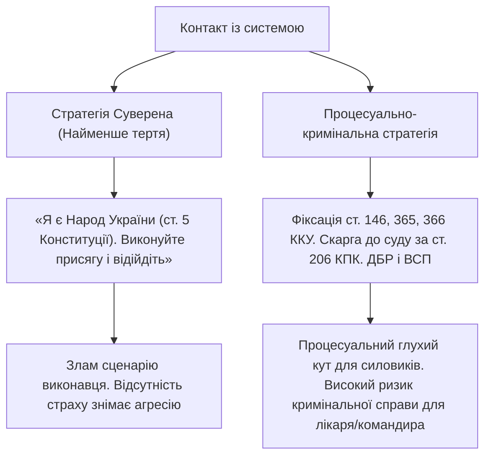

# Практичний путівник взаємодії з системою (Playbook)

> - [Етап 1: Вулиця та блокпост — тверда позиція суверена розбиває свавілля патруля.](#етап-1-зупинка-на-вулиці--блокпост-поліція-та-тцк)
> - [Етап 2: Спроба силового примусу — чітка кваліфікація викрадення ламає конвеєр.](#етап-2-спроба-силового-доставлення-бусифікація)
> - [Етап 3: Медичний зашморг ВЛК — відмова від підробки зупиняє оформлення приказу.](#етап-3-медичний-кабінет-влк-відмова-від-службового-підроблення)
> - [Етап 4: КПП та військова частина — відсутність статусу і відмова від злочинного наказу.](#етап-4-розподільчий-пункт-або-територія-військової-частини)
> - [Порівняльна матриця стратегій — обирай свій рівень глибини і дієвості.](#порівняльна-матриця-стратегій-на-кожному-етапі)

---

> _«Кому ви давали присягу? Народові України? Я і є Український Народ. Стаття 5 Конституції України. Моя воля первинна. Виконуйте свою присягу і відійдіть»._

---

## Як користуватися цим путівником

Цей документ побудований за фрактальним принципом:
1. **Визначте точку, де ви або ваші близькі перебуваєте прямо зараз** (Етапи 1–4).
2. **Перейдіть за посиланням до відповідного розділу** та застосуйте конкретні фрази й дії.
3. **Оберіть стратегію**: 
   - **Суверенна (Пряма дія Конституції)** — позиція Людини як єдиного джерела влади (ст. 5 Конституції України). Дає **найменший опір і тертя**, оскільки повністю ламає скрипт психопатів та виконавців.
   - **Процесуально-кримінальна** — фіксація тяжких злочинів (ст. 146, 365, 366, 371 КК України), залучення слідчих органів (ДБР, ВСП, слідчий суддя за ст. 206 КПК).

---

## Етап 1: Зупинка на вулиці / блокпост (Поліція та ТЦК)

### Суть етапу
Система намагається встановити над вами юрисдикцію через страх, перевірку документів або залякування ст. 65 Конституції. Якщо ви починаєте виправдовуватися чи показувати довідки — система сприймає це як визнання підлеглості.

### Дії та формулювання:

| Дія | Стратегія Суверена (Пряма дія) | Процесуально-кримінальна стратегія |
| :--- | :--- | :--- |
| **Звернення силовика** | «На підставі якої норми Конституції ви обмежуєте мій рух? Ст. 19 зобов'язує вас діяти виключно в межах закону». | «Назвіть підставу зупинки згідно зі ст. 35 Закону "Про Національну поліцію". Назвіть прізвище, посаду і пред'явіть службове посвідчення». |
| **Вимога показати документи** | «Я Людина, носій суверенітету (ст. 5 Конституції). Документів для опричників не ношу і надавати не збираюся». | «Перевірка документів можлива лише у вичерпних 6 випадках ст. 32 Закону "Про Нацполіцію". Жодного правопорушення я не вчиняю». |
| **Спроба залякати присягою/боргом** | **«Кому ви давали присягу? Народові? Я і є Український Народ. Виконуйте присягу і захищайте мої права»**. | «Стаття 65 Конституції діє виключно "відповідно до закону". Жоден закон не дає права затримувати на вулиці без ухвали суду». |
| **Маніпуляція про "депортацію" чи "ти не громадянин"** | «Куди депортувати? Я на своїй Богом даній землі. Це ви самозванці, що діють проти свого народу». | «Стаття 25 Конституції: громадянин України не може бути позбавлений громадянства або висланий за межі України». |

---

## Етап 2: Спроба силового доставлення («Бусифікація»)

### Суть етапу
Спроба насильницького затягування до цивільного чи службового авто без ухвали слідчого судді та без протоколу затримання (ст. 208 КПК).

### Дії та формулювання:

| Дія | Стратегія Суверена (Пряма дія) | Процесуально-кримінальна стратегія |
| :--- | :--- | :--- |
| **Фізичний напад** | Гучно на вулицю: «Озброєні люди нападають на Людину! Свавілля та замах на життя!». Повний фізичний опір кріпацтву. | Голосно під запис: «Стаття 146 КК — викрадення людини! Стаття 365 КК — перевищення влади! Ви вчиняєте закінчений злочин!». |
| **Спроба посадити в авто** | «Я не даю згоди на переміщення. Кожен, хто торкається мого тіла, несе особисту карну відповідальність перед Родом і Народом». | Вимагати: 1. Ухвалу слідчого судді; 2. Протокол затримання за ст. 208 КПК з залученням безоплатного адвоката. |
| **Дії близьких ззовні** | Терміновий дзвінок 102 з фіксацією злочину викрадення. Виїзд до будівлі ТЦК. Передача шаблону заяви [statement-kidnapping.md](./templates/statement-kidnapping.md). | Подання заяви до ДБР за ст. 214 КПК, звернення до слідчого судді за ст. 206 КПК України для негайного звільнення заручника. |

---

## Етап 3: Медичний кабінет ВЛК (Відмова від службового підроблення)

### Суть етапу
ВЛК — єдиний юридичний шлюз для системи. Без підписаного висновку ВЛК наказ про призов видати неможливо. Лікарі ВЛК — цивільні наймані працівники, які несуть індивідуальну кримінальну відповідальність за підроблення.

### Дії та формулювання:

| Дія | Стратегія Суверена (Пряма дія) | Процесуально-кримінальна стратегія |
| :--- | :--- | :--- |
| **Захід до лікаря** | «Я перебуваю тут як викрадена людина, проти волі. Я не даю згоди на медичні маніпуляції та огляди у полоні». | «Я відмовляюся від проходження експрес-огляду без моєї амбулаторної карти, результатів обов'язкових аналізів і рентгену». |
| **Спроба поставити штамп «придатний»** | «Стаття 366 КК України — службове підроблення. Мої рідні вже зафіксували злочин у ДБР. Ваше прізвище буде в матеріалах розслідування». | «Огляд за 2 хвилини без діагностики є злочином. Зафіксуйте мої письмові скарги на стан здоров'я та видайте направлення на стаціонар». |
| **Підписи на бланках** | **Категорична відмова ставити будь-який підпис.** Жодних підписів про «згоду», «добровільність» чи пустих аркушів. | Письмова відмова: «Підпис не ставлю у зв'язку з незаконним утриманням та відсутністю медичної документації». |

---

## Етап 4: Розподільчий пункт або територія військової частини

### Суть етапу
Якщо людину силою завезли на територію військової частини, командування частини намагається видати наказ про зарахування до списків частини, щоб перевести статус особи у «військовослужбовця».

### Дії та формулювання:

| Дія | Стратегія Суверена (Пряма дія) | Процесуально-кримінальна стратегія |
| :--- | :--- | :--- |
| **Складення Військової присяги** | **«Я НЕ СКЛАДАЮ ПРИСЯГУ. Присяга — це священний акт волі. Я не служу найманцям і олігархам»**. Без присяги обов'язки військової служби не виникають. | Відмова від складання присяги. Посилання на ст. 60 Конституції: наказ про примусове складення присяги є явно злочинним. |
| **Військова форма та зброя** | **Категорична відмова брати зброю, набої та одягати форму.** Не розписуватися за жодне речове або грошове забезпечення. | Не ставати на котлове забезпечення (харчуватися за власний кошт/передачі), не приймати зброю під розпис. |
| **Подання рапорту командиру** | Вручення роздрукованого рапорту [report-refusal-illegal-order.md](./templates/report-refusal-illegal-order.md) або [report-longterm-hostage-refusal.md](./templates/report-longterm-hostage-refusal.md). | Вимога зареєструвати рапорт у журналі вхідної кореспонденції, надати 2-й примірник зі вхідним номером та викликати ВСП і ДБР. |
| **Погрози за «непокору» (ст. 402) чи «СЗЧ» (ст. 407)** | «Ці статті стосуються військовослужбовців. Я цивільна людина, незаконно утримувана силою. Ви — співучасники викрадення (ст. 146 КК)». | «Спроба застосувати військові статті до викраденої цивільної особи — це стаття 371 КК України (завідомо незаконне тримання під вартою)». |

---

## Порівняльна матриця стратегій на кожному етапі

### Зведена таблиця:

| Параметр | Стратегія Суверена (Пряма дія) | Процесуально-кримінальна стратегія |
| :--- | :--- | :--- |
| **Філософська основа** | Людина — первинне джерело влади і суверенітету (ст. 3, 5 Конституції). | Дотримання процедур, передбачених законами та кодексами (КПК, ККУ). |
| **Рівень внутрішнього тертя** | **Мінімальний.** Немає суперечок про статті чи довідки — пряма декларація Волі. | **Середній.** Вимагає знання номерів статей, вимоги протоколів і заяв. |
| **Вразливість перед системою** | Нульова для духовно зрілої Людини без страху. | Може зіткнутися з саботажем і круговою порукою чергових частин. |
| **Головна зброя** | Стаття 5, 19, 60 Конституції України, моральна перевага і крижаний спокій. | Стаття 146, 365, 366 КК України, стаття 206 КПК України, заяви до ДБР та суду. |
| **Результат** | Система усвідомлює неможливість підпорядкування і відступає. | Система отримує документальні підтвердження злочину і змушена звільнити особу. |
