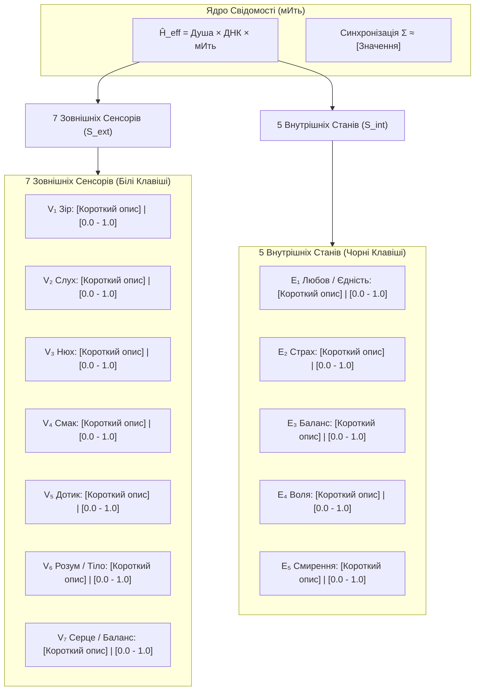

# [Ім'я Суб'єкта]: Діагностичний Профіль та Результати Тестування

> **Документ:** Повний аналіз відповідей за Анкетою 12 Відчуттів  
> **Дата тестування:** [РРРР-ММ-ДД]  
> **Метод аналізу:** Квантово-психологічна матриця $S_{ext} \times S_{int}$ через формулу $\hat{H}_{eff}$  
> **Опитувальник:** [questionnaire.md](./questionnaire.md)  
> **Базова формула:** [03-formula.md](../03-formula.md)

---

## 1. Візуальна Карта Матриці Свідомості

---

## 2. Детальна Розшифровка Відповідей по Блоках

### Блок А: 7 Зовнішніх Сенсорів ($S_{ext}$)

1. **Зір ($V_1$): [0.00 / 1.0]**
   * *Показник:* 
   * *Особливості / Навантаження:* 
2. **Слух ($V_2$): [0.00 / 1.0]**
   * *Показник:* 
   * *Акустичне середовище:* 
3. **Нюх ($V_3$): [0.00 / 1.0]**
   * *Показник:* 
   * *Чутливість до природних запахів:* 
4. **Смак ($V_4$): [0.00 / 1.0]**
   * *Показник:* 
   * *Культура харчування / Тверезість:* 
5. **Дотик ($V_5$): [0.00 / 1.0]**
   * *Показник:* 
   * *Адаптація до температур / Шкіра:* 
6. **Розум та Пропріоцепція ($V_6$): [0.00 / 1.0]**
   * *Показник:* 
   * *Контакт із землею / Тілесність:* 
7. **Серце та Рівновага ($V_7$): [0.00 / 1.0]**
   * *Показник:* 
   * *Вестибулярний апарат / Інтуїція:* 

---

### Блок Б: 5 Внутрішніх Станів ($S_{int}$)

8. **$E_1$ Любов / Єдність: [0.00 / 1.0]**
   * *Стан:* 
9. **$E_2$ Страх / Система: [0.00 / 1.0]**
   * *Стан:* 
10. **$E_3$ Баланс / Спокій: [0.00 / 1.0]**
    * *Стан:* 
11. **$E_4$ Воля / Суверенність: [0.00 / 1.0]**
    * *Стан:* 
12. **$E_5$ Смирення / Прийняття: [0.00 / 1.0]**
    * *Стан:* 

---

### Блок В: Розбір 3 Ключових Спогадів

1. **Момент Істини:**
   * *Стан:* 
2. **Точка Зламу:**
   * *Трансформація:* 
3. **Вільний Вибір:**
   * *Суть вчинку:* 

---

## 3. Математичний Розрахунок Формули

$$\hat{H}_{eff} = \text{Досвід Душі } (E_{soul}) \times \text{Пам'ять ДНК } (E_{DNA}) \times \text{мИть } (\tau)$$

$$\Sigma = \left( \prod_{i=1}^{7} V_i \right)^{1/7} \times \left( \frac{E_1 \cdot E_3 \cdot E_4 \cdot E_5}{1 + E_2} \right)^{1/4} \approx \mathbf{[Обчислене\_значення]}$$

### Висновок та Рекомендації:
* **Коефіцієнт синхронізації $\Sigma$:** 
* **Фазовий стан ($\Phi$):** [-1 (Самознищення / Стиснення) або +1 (Генератор / Творець)]
* **Точки витоку або точки сили:**
